# 🏗️ Arquitectura y Documentación Técnica - Email Validator API v2.0.0

> **Documentación completa con diagramas Mermaid, flujos de datos, arquitectura de componentes y especificaciones técnicas.**

---

## 📑 Índice

1. [Visión General de Arquitectura](#-visión-general-de-arquitectura)
2. [Diagrama de Componentes](#-diagrama-de-componentes)
3. [Flujo de Validación Completo](#-flujo-de-validación-completo)
4. [Transacción SMTP Detallada](#-transacción-smtp-detallada)
4. [Pipeline de Procesamiento](#-pipeline-de-procesamiento)
5. [Arquitectura de Cache y Pool](#-arquitectura-de-cache-y-pool)
6. [Modelos de Datos](#-modelos-de-datos)
7. [Manejo de Errores y Códigos](#-manejo-de-errores-y-códigos)
8. [Despliegue y Operación](#-despliegue-y-operación)
9. [Métricas y Observabilidad](#-métricas-y-observabilidad)
10. [Seguridad](#-seguridad)

---

## 🎯 Visión General de Arquitectura

El **Email Validator API v2.0.0** es un microservicio REST de alto rendimiento desarrollado en **Rust** que valida correos electrónicos mediante tres niveles de verificación:

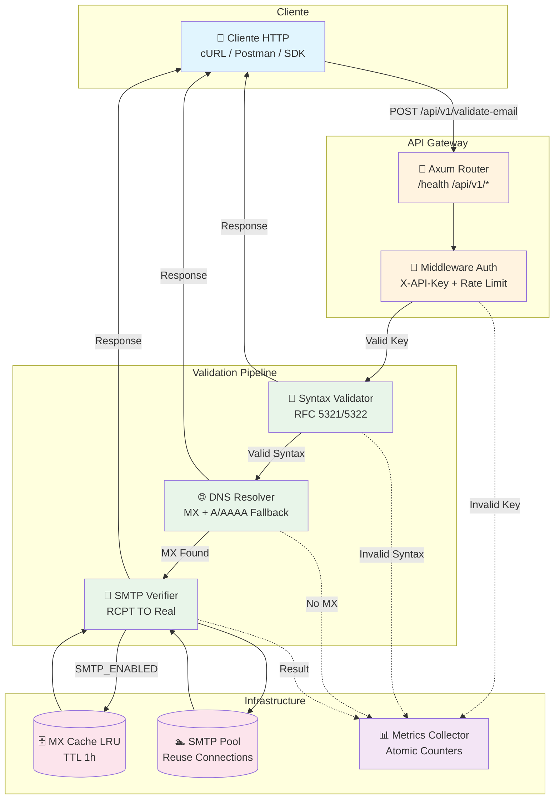

### Capas de Verificación

| Nivel | Descripción | RFC | Habilitado por Defecto |
|-------|-------------|-----|------------------------|
| **1. Sintaxis** | Validación RFC 5321/5322 completa | 5321, 5322 | ✅ Siempre |
| **2. DNS MX** | Resolución MX + Fallback A/AAAA + Null MX | 5321, 7505 | ✅ Siempre |
| **3. SMTP Real** | Conexión TCP + EHLO + STARTTLS + RCPT TO | 5321 | ⚙️ `SMTP_VERIFICATION_ENABLED` |

---

## 🧩 Diagrama de Componentes

### Cargo Workspace Structure

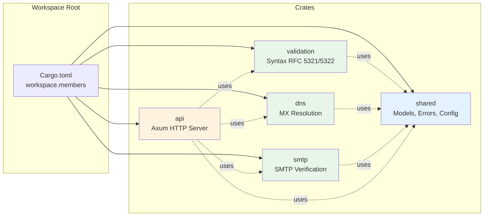

### Dependency Graph

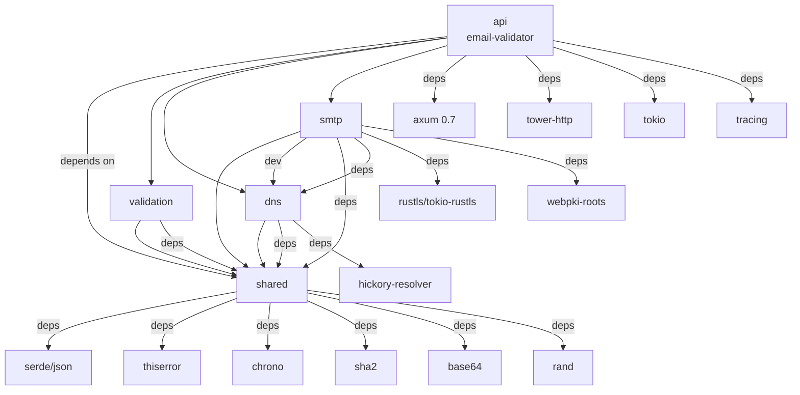

---

## 🔄 Flujo de Validación Completo

### Sequence Diagram - Request Processing

```mermaid
sequenceDiagram
    participant Client
    participant Router
    participant Auth
    participant RateLimiter
    participant SyntaxValidator
    participant DNSResolver
    participant Cache
    participant SMTPVerifier
    participant Pool
    participant Metrics
    
    Client->>Router: POST /api/v1/validate-email<br/>{"email": "user@domain.com"}<br/>X-API-Key: xxx
    Router->>Metrics: record_request()
    Router->>Auth: Validate X-API-Key
    
    alt Invalid API Key
        Auth-->>Client: 401 Unauthorized<br/>{error, error_code: 6}
        Metrics->>Metrics: record_auth_failure()
    else Valid API Key
        Auth->>RateLimiter: check(api_key)
        
        alt Rate Limited
            RateLimiter-->>Client: 429 Too Many Requests<br/>{error, error_code: 7}
            Metrics->>Metrics: record_rate_limit_hit()
        else OK
            RateLimiter->>KeyManager: increment_usage()
            RateLimiter->>SyntaxValidator: validate_email_syntax(email)
            
            alt Invalid Syntax
                SyntaxValidator-->>Client: 200 OK<br/>{is_valid_syntax: false, error_code: 2}
                Metrics->>Metrics: record_syntax_error()
                DomainTracker->>DomainTracker: record(domain, "syntax")
            else Valid Syntax
                SyntaxValidator->>DNSResolver: resolve_mx_records(domain)
                
                alt DNS Error
                    DNSResolver-->>Client: 200 OK<br/>{error_code: 5, has_mx: false}
                    Metrics->>Metrics: record_dns_error()
                else Null MX (RFC 7505)
                    DNSResolver-->>Client: 200 OK<br/>{error_code: 4, has_mx: false}
                else No MX Records
                    DNSResolver-->>Client: 200 OK<br/>{error_code: 3, has_mx: false}
                else MX Found
                    DNSResolver->>Cache: get(domain)
                    
                    alt Cache Miss
                        Cache->>DNSResolver: resolve fresh
                        DNSResolver-->>Cache: MX records
                        Cache->>Cache: store with TTL
                    else Cache Hit
                        Cache-->>SMTPVerifier: cached MX records
                    end
                    
                    alt SMTP_VERIFICATION_ENABLED = false
                        SMTPVerifier-->>Client: 200 OK<br/>{is_deliverable: true, has_mx: true}
                    else SMTP_VERIFICATION_ENABLED = true
                        SMTPVerifier->>SMTPVerifier: sort MX by priority
                        
                        loop For each MX (priority order)
                            SMTPVerifier->>Pool: get_connection(host, port)
                            
                            alt Connection from Pool
                                Pool-->>SMTPVerifier: Reused connection
                            else New Connection
                                Pool->>Pool: Create TCP/TLS connection
                                Pool-->>SMTPVerifier: New connection
                            end
                            
                            SMTPVerifier->>SMTPVerifier: SMTP Transaction
                            
                            alt Deliverable (250)
                                SMTPVerifier-->>Client: 200 OK<br/>{is_deliverable: true, smtp: Deliverable}
                                break
                            else Permanent Failure (550,551,552,553,554)
                                SMTPVerifier-->>Client: 200 OK<br/>{is_deliverable: false, error_code: 9}
                                break
                            else Temporary Failure (450,451,452)
                                SMTPVerifier->>SMTPVerifier: Retry with backoff
                                
                                alt Max Retries Exceeded
                                    SMTPVerifier-->>Client: 200 OK<br/>{error_code: 11}
                                end
                            else Connection Error
                                SMTPVerifier->>SMTPVerifier: Try next MX
                            end
                        end
                        
                        SMTPVerifier->>Pool: return_connection()
                        Pool->>Pool: Mark idle, update last_used
                    end
                    
                    Metrics->>Metrics: record_processed(has_mx, latency)
                    DomainTracker->>DomainTracker: record if needed
            end
        end
    end
```

### Decision Flow - Validation Logic

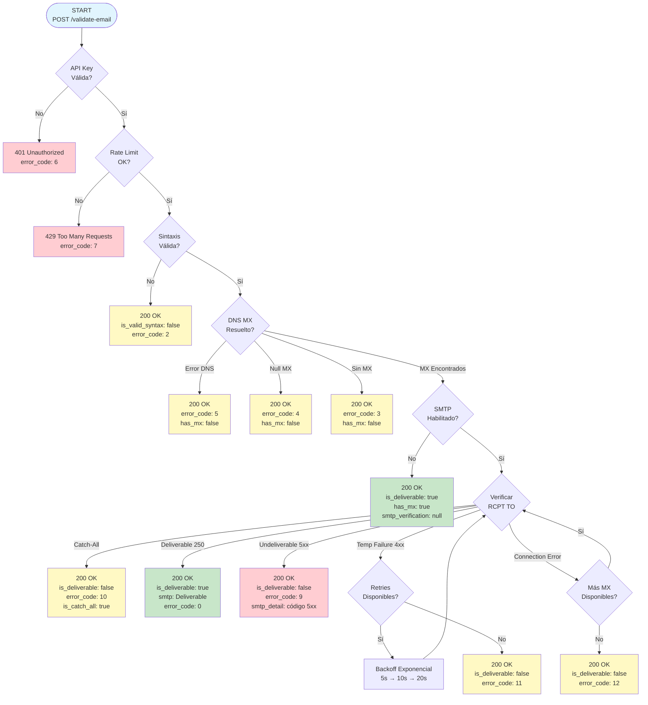

---

## 📧 Transacción SMTP Detallada

### SMTP Protocol Flow

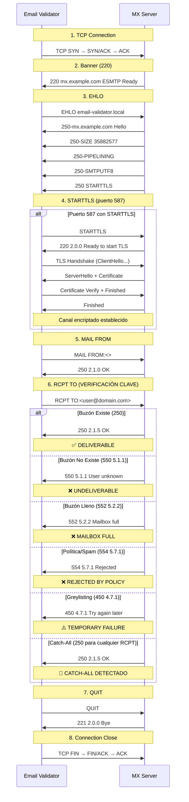

### Port Fallback Strategy

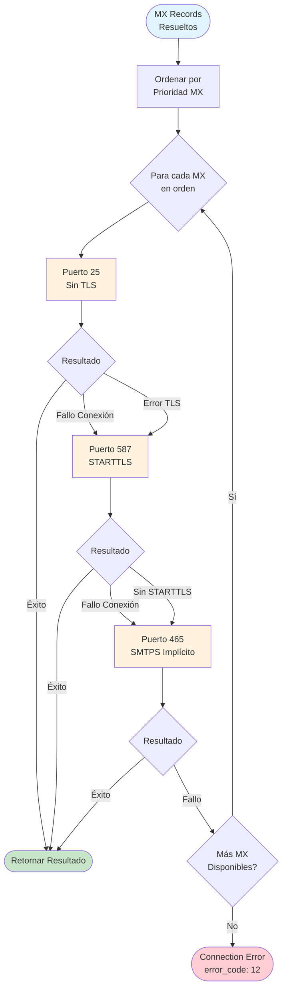

### SMTP Response Code Mapping

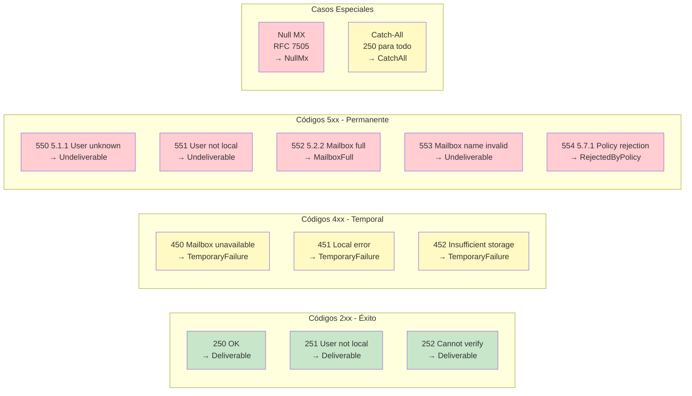

---

## ⚙️ Pipeline de Procesamiento

### Pipeline Architecture

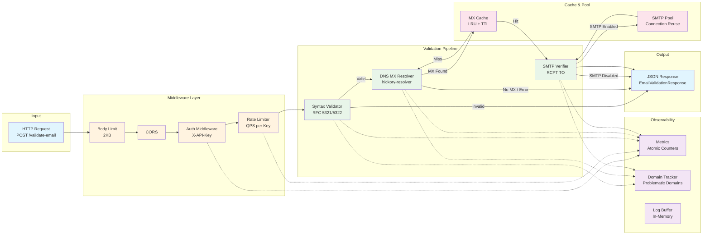

### Processing Stages Detail

```mermaid
flowchart TD
    subgraph "Stage 1: Authentication & Rate Limiting"
        S1A[Extract X-API-Key<br/>from Header]
        S1B[KeyManager.validate_key<br/>Active + Not Expired]
        S1C[RateLimiter.check<br/>QPS per Key]
        S1D[KeyManager.increment_usage]
    end
    
    subgraph "Stage 2: Syntax Validation"
        S2A[validate_email_syntax<br/>RFC 5321/5322]
        S2B[Length Checks<br/>Total ≤254, Local ≤64, Domain ≤253]
        S2C[Local Part Rules<br/>No leading/trailing dots, no ..]
        S2D[Domain Rules<br/>Labels ≤63, no leading/trailing hyphens]
        S2E[TLD Validation<br/>>=2 chars, not all-numeric]
    end
    
    subgraph "Stage 3: DNS Resolution"
        S3A[hickory-resolver<br/>MX Lookup]
        S3B[Null MX Check<br/>RFC 7505: pref=0, exchange=.<br/>]
        S3C[MX Cache Lookup<br/>LRU + TTL]
        S3D[Fallback A/AAAA<br/>RFC 5321 §5.1]
        S3E[Sort by Priority<br/>Lower = Higher Priority]
    end
    
    subgraph "Stage 4: SMTP Verification"
        S4A[SMTP_VERIFICATION_ENABLED<br/>Env Var Check]
        S4B[Connection Pool<br/>Get/Reuse Connection]
        S4C[TCP Connect<br/>Port 25/587/465]
        S4D[EHLO + Capabilities<br/>Parse STARTTLS, SIZE, etc.]
        S4E[STARTTLS Upgrade<br/>Port 587]
        S4F[MAIL FROM:<>]
        S4G[RCPT TO:<email><br/>KEY VALIDATION STEP]
        S4H[Parse Response Code<br/>250/450/550/551/552/553/554]
        S4I[Catch-All Detection<br/>Random email test]
        S4J[Retry Logic<br/>Backoff on 4xx]
        S4K[Return to Pool<br/>Mark Idle]
    end
    
    S1A --> S1B --> S1C --> S1D
    S1D --> S2A --> S2B --> S2C --> S2D --> S2E
    S2E --> S3A --> S3B --> S3C --> S3D --> S3E
    S3E --> S4A
    S4A -->|Disabled| OUT1[Return MX-only result]
    S4A -->|Enabled| S4B --> S4C --> S4D --> S4E --> S4F --> S4G --> S4H --> S4I --> S4J --> S4K
    S4K --> OUT2[Return Full result]
```

---

## 🗄️ Arquitectura de Cache y Pool

### MX Cache (LRU con TTL)

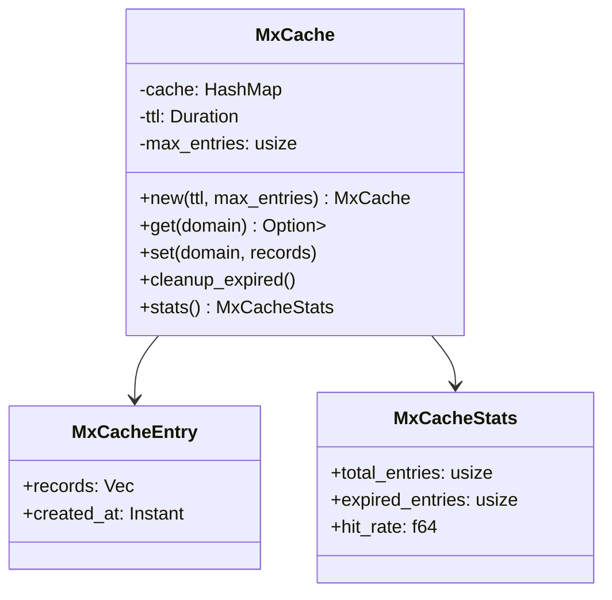

### MX Cache Flow

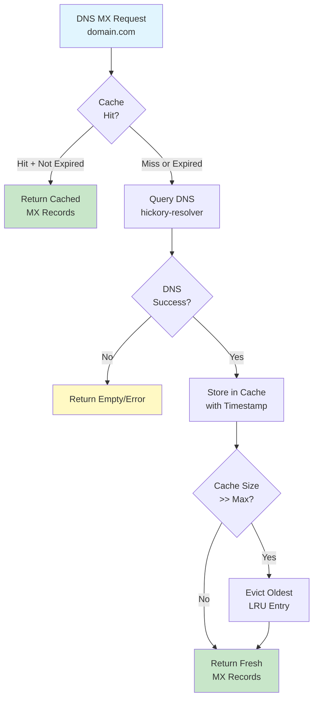

### SMTP Connection Pool

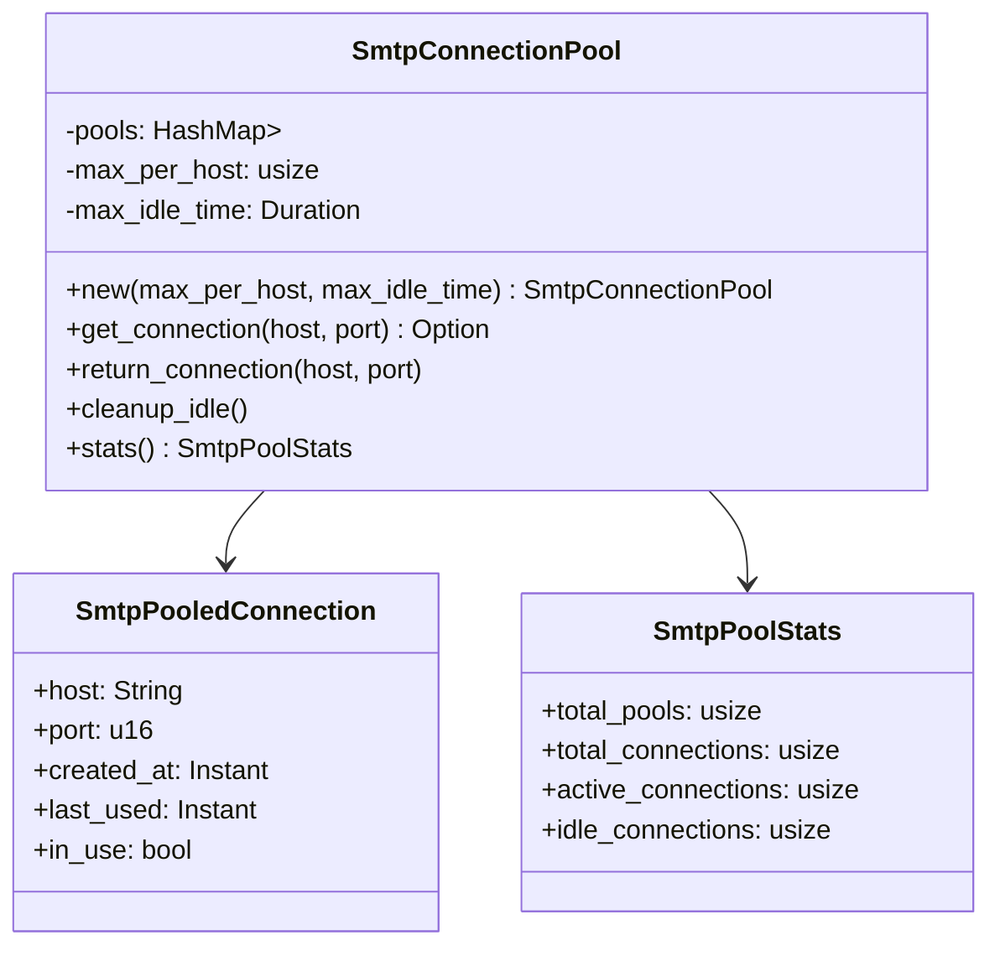

### Pool Lifecycle

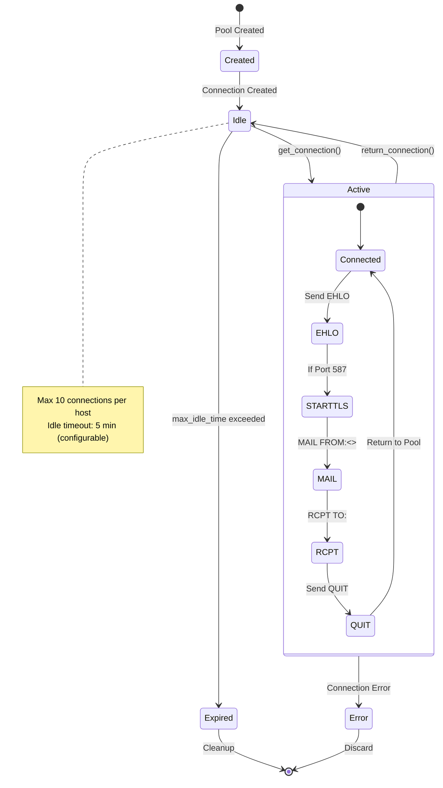

---

## 📊 Modelos de Datos

### Core Data Structures

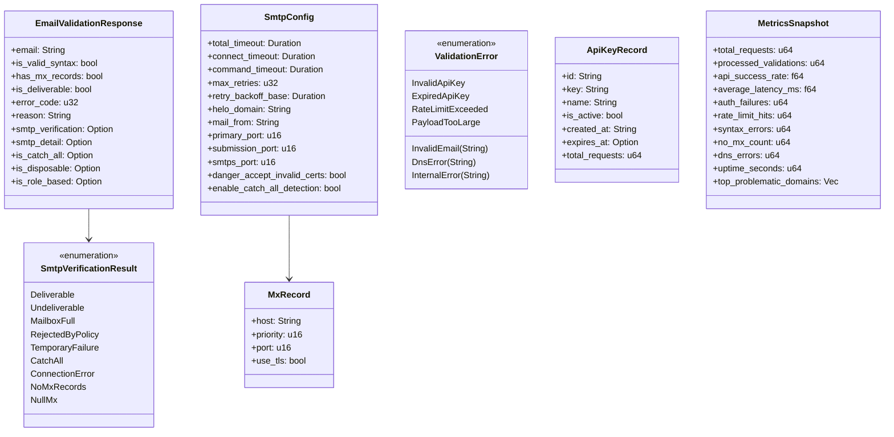

### Response Examples by Scenario

```mermaid
graph TD
    subgraph "Syntax Error (error_code: 2)"
        SE[{
  "email": "user@.com",
  "is_valid_syntax": false,
  "has_mx_records": false,
  "is_deliverable": false,
  "error_code": 2,
  "reason": "El dominio no puede comenzar ni terminar con un punto"
}]
    end
    
    subgraph "No MX Records (error_code: 3)"
        NMX[{
  "email": "user@nonexistent123.com",
  "is_valid_syntax": true,
  "has_mx_records": false,
  "is_deliverable": false,
  "error_code": 3,
  "reason": "El dominio no posee servidores de correo..."
}]
    end
    
    subgraph "Null MX (error_code: 4)"
        NUL[{
  "email": "user@nullmx.example.com",
  "is_valid_syntax": true,
  "has_mx_records": false,
  "is_deliverable": false,
  "error_code": 4,
  "reason": "El dominio declara explícitamente que no acepta correo..."
}]
    end
    
    subgraph "MX Only - No SMTP (error_code: 0)"
        MXO[{
  "email": "user@gmail.com",
  "is_valid_syntax": true,
  "has_mx_records": true,
  "is_deliverable": true,
  "error_code": 0,
  "reason": "Correo válido y con registros MX encontrados",
  "smtp_verification": null
}]
    end
    
    subgraph "SMTP Deliverable (error_code: 0)"
        SMD[{
  "email": "user@gmail.com",
  "is_valid_syntax": true,
  "has_mx_records": true,
  "is_deliverable": true,
  "error_code": 0,
  "reason": "Correo válido y buzón confirmado entregable...",
  "smtp_verification": "Deliverable",
  "smtp_detail": "Correo válido y buzón confirmado...",
  "is_catch_all": false,
  "is_disposable": false,
  "is_role_based": false
}]
    end
    
    subgraph "SMTP Undeliverable (error_code: 9)"
        SMU[{
  "email": "fake123@gmail.com",
  "is_valid_syntax": true,
  "has_mx_records": true,
  "is_deliverable": false,
  "error_code": 9,
  "reason": "Buzón inexistente (SMTP 550 5.1.1)",
  "smtp_verification": "Undeliverable",
  "smtp_detail": "550 5.1.1 The email account...does not exist",
  "is_catch_all": false
}]
    end
    
    subgraph "Catch-All (error_code: 10)"
        CAT[{
  "email": "random@catchall.com",
  "is_valid_syntax": true,
  "has_mx_records": true,
  "is_deliverable": false,
  "error_code": 10,
  "reason": "Dominio catch-all - acepta cualquier destinatario...",
  "smtp_verification": "CatchAll",
  "is_catch_all": true
}]
    end
    
    subgraph "Temporary Failure (error_code: 11)"
        TMP[{
  "email": "user@greylist.com",
  "is_valid_syntax": true,
  "has_mx_records": true,
  "is_deliverable": false,
  "error_code": 11,
  "reason": "Fallo temporal - greylisting o servidor ocupado...",
  "smtp_verification": "TemporaryFailure"
}]
    end
    
    subgraph "Disposable Email (error_code: 13)"
        DISP[{
  "email": "test@temp-mail.org",
  "is_valid_syntax": true,
  "has_mx_records": true,
  "is_deliverable": false,
  "error_code": 13,
  "reason": "Email desechable detectado (dominio temporal conocido)",
  "is_disposable": true
}]
    end
    
    subgraph "Role-Based Email (error_code: 14)"
        ROLE[{
  "email": "admin@example.com",
  "is_valid_syntax": true,
  "has_mx_records": true,
  "is_deliverable": true,
  "error_code": 0,
  "reason": "Correo válido y buzón confirmado entregable...",
  "smtp_verification": "Deliverable",
  "is_role_based": true
}]
    end
```

---

## ⚠️ Manejo de Errores y Códigos

### Error Code Registry

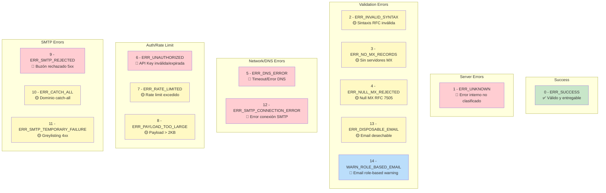

### HTTP Status Code Mapping

| Error Code | Constante | HTTP Status | Category |
|------------|-----------|-------------|----------|
| 0 | ERR_SUCCESS | 200 OK | Success |
| 1 | ERR_UNKNOWN | 500 | Server Error |
| 2 | ERR_INVALID_SYNTAX | 200 OK / 400 | Validation |
| 3 | ERR_NO_MX_RECORDS | 200 OK | Validation |
| 4 | ERR_NULL_MX_REJECTED | 200 OK | Validation |
| 5 | ERR_DNS_ERROR | 200 OK / 502 | Network |
| 6 | ERR_UNAUTHORIZED | 401 | Auth |
| 7 | ERR_RATE_LIMITED | 429 | Rate Limit |
| 8 | ERR_PAYLOAD_TOO_LARGE | 413 | Validation |
| 9 | ERR_SMTP_REJECTED | 200 OK | SMTP |
| 10 | ERR_CATCH_ALL | 200 OK | SMTP |
| 11 | ERR_SMTP_TEMPORARY_FAILURE | 200 OK | SMTP |
| 12 | ERR_SMTP_CONNECTION_ERROR | 200 OK | Network |
| 13 | ERR_DISPOSABLE_EMAIL | 200 OK | Quality |
| 14 | WARN_ROLE_BASED_EMAIL | 200 OK | Quality |

---

## 🐳 Despliegue y Operación

### Docker Architecture

```mermaid
graph TB
    subgraph "Host Machine"
        Docker[Docker Engine]
    end
    
    subgraph "Container: email-validator-api"
        App[Email Validator Binary<br/>Rust Release Build]
        Config[.env Config<br/>Volume Mount]
        Data[/app/data<br/>Volume Mount]
    end
    
    subgraph "Network"
        Port3000[Port 3000<br/>Host ↔ Container]
        DNS[DNS Resolution<br/>Host Network/Container DNS]
    end
    
    subgraph "External Dependencies"
        MXServers[MX Servers<br/>Port 25/587/465]
        DNSServers[DNS Servers<br/>UDP 53]
    end
    
    Docker --> App
    App --> Config
    App --> Data
    App --> Port3000
    App --> DNS
    DNS --> DNSServers
    App -.->|SMTP_VERIFICATION_ENABLED| MXServers
    
    style App fill:#e1f5fe
    style Config fill:#fff3e0
    style Data fill:#fff3e0
    style MXServers fill:#fff9c4
    style DNSServers fill:#fff9c4
```

### Docker Compose Service Definition

```yaml
# docker-compose.yml
services:
  email-validator:
    build:
      context: .
      dockerfile: Dockerfile
    container_name: email-validator-api
    ports:
      - "3000:3000"
    environment:
      - API_KEY=${API_KEY}
      - ADMIN_USER=${ADMIN_USER}
      - ADMIN_PASSWORD=${ADMIN_PASSWORD}
      - ALLOWED_ORIGINS=${ALLOWED_ORIGINS}
      - PORT=3000
      - RATE_LIMIT_QPS=${RATE_LIMIT_QPS}
      - RUST_LOG=${RUST_LOG}
      # SMTP Configuration
      - SMTP_VERIFICATION_ENABLED=${SMTP_VERIFICATION_ENABLED:-false}
      - SMTP_CONNECT_TIMEOUT_SECS=${SMTP_CONNECT_TIMEOUT_SECS:-10}
      - SMTP_COMMAND_TIMEOUT_SECS=${SMTP_COMMAND_TIMEOUT_SECS:-10}
      - SMTP_MAX_RETRIES=${SMTP_MAX_RETRIES:-2}
    volumes:
      - ./data:/app/data
    restart: unless-stopped
    healthcheck:
      test: ["CMD", "curl", "-f", "http://localhost:3000/health"]
      interval: 30s
      timeout: 10s
      retries: 3
      start_period: 10s
    networks:
      - email-validator-net
    mem_limit: 256m
    cpus: "1.0"
```

### Multi-stage Dockerfile

```mermaid
flowchart TD
    subgraph "Build Stage"
        Base1[FROM rust:latest AS builder]
        Workdir1[WORKDIR /app]
        Install1[RUN apt-get update && install<br/>pkg-config libssl-dev]
        Copy1[COPY Cargo.toml packages/]
        Build1[RUN cargo build --release<br/>--bin email-validator]
    end
    
    subgraph "Runtime Stage"
        Base2[FROM debian:bookworm-slim]
        Workdir2[WORKDIR /app]
        Install2[RUN apt-get update && install<br/>ca-certificates curl<br/>useradd -m -u 1000 appuser]
        Copy2[COPY --from=builder /app/target/release/email-validator .]
        Perms2[RUN chmod +x ./email-validator<br/>chown -R appuser:appuser /app]
        User2[USER appuser]
        Env2[ENV DATA_DIR=/app/data]
        Expose2[EXPOSE 3000]
        Health2[HEALTHCHECK curl -f<br/>http://localhost:3000/health]
        Cmd2[CMD [./email-validator]]
    end
    
    Base1 --> Workdir1 --> Install1 --> Copy1 --> Build1
    Build1 --> Base2
    Base2 --> Workdir2 --> Install2 --> Copy2 --> Perms2 --> User2 --> Env2 --> Expose2 --> Health2 --> Cmd2
```

### Required Ports & Firewall Rules

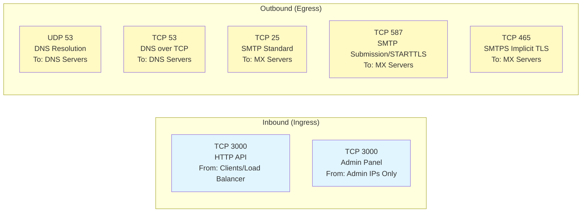

---

## 📈 Métricas y Observabilidad

### Metrics Architecture

```mermaid
graph TB
    subgraph "Collection"
        Atomic[AtomicMetrics<br/>Lock-free Counters]
        Domain[DomainTracker<br/>Problematic Domains]
        Logs[LogBuffer<br/>In-Memory Ring Buffer]
    end
    
    subgraph "Aggregation"
        Snapshot[MetricsSnapshot<br/>Computed on Demand]
    end
    
    subgraph "Exposure"
        AdminAPI[GET /api/v1/admin/metrics<br/>Basic Auth]
        Prometheus[Future: /metrics<br/>Prometheus Format]
        LogsAPI[GET /api/v1/admin/logs<br/>Recent Logs]
    end
    
    Atomic --> Snapshot
    Domain --> Snapshot
    Logs --> LogsAPI
    Snapshot --> AdminAPI
    Snapshot --> Prometheus
    
    style Atomic fill:#e8f5e9
    style Domain fill:#e8f5e9
    style Logs fill:#e8f5e9
    style Snapshot fill:#fff3e0
    style AdminAPI fill:#e1f5fe
    style Prometheus fill:#e1f5fe
    style LogsAPI fill:#e1f5fe
```

### Key Metrics

```mermaid
graph LR
    subgraph "Request Metrics"
        M1[total_requests<br/>Total HTTP requests received]
        M2[processed_validations<br/>Validations completed]
        M3[api_success_rate<br/>% requests without server errors]
        M4[average_latency_ms<br/>Mean processing time]
    end
    
    subgraph "Error Metrics"
        M5[auth_failures<br/>401 Unauthorized]
        M6[rate_limit_hits<br/>429 Too Many Requests]
        M7[syntax_errors<br/>Invalid email syntax]
        M8[no_mx_count<br/>Domains without MX]
        M9[dns_errors<br/>DNS resolution failures]
    end
    
    subgraph "SMTP Metrics (v2.0)"
        M10[smtp_verifications_total<br/>Total SMTP attempts]
        M11[smtp_deliverable<br/>RCPT TO 250]
        M12[smtp_undeliverable<br/>RCPT TO 5xx]
        M13[smtp_temporary_failure<br/>RCPT TO 4xx]
        M14[smtp_connection_errors<br/>Connection/Timeout]
        M15[smtp_catch_all<br/>Catch-all domains]
        M16[mx_cache_hits/misses<br/>Cache performance]
        M17[smtp_pool_size<br/>Active connections]
    end
    
    subgraph "Domain Intelligence"
        M18[top_problematic_domains<br/>Recurring bad domains]
        M19[disposable_detected<br/>Temp email domains]
        M20[role_based_detected<br/>admin@, info@, etc.]
    end
```

### Admin Dashboard Endpoints

```mermaid
graph TD
    Admin[Admin Panel<br/>http://host:3000/admin] --> Login[Basic Auth<br/>Username + Password]
    
    Login --> Dashboard[Dashboard<br/>Real-time Metrics]
    Login --> Metrics[GET /api/v1/admin/metrics<br/>JSON MetricsSnapshot]
    Login --> Logs[GET /api/v1/admin/logs<br/>Recent Log Entries]
    Login --> Keys[GET/POST/DELETE<br/>/api/v1/admin/keys<br/>API Key Management]
    Login --> Password[POST /api/v1/admin/password<br/>Change Admin Password]
    
    Dashboard --> Charts[Latency Charts<br/>Error Rate<br/>Throughput]
    Dashboard --> Tables[Top Domains<br/>Error Breakdown]
```

---

## 🔒 Seguridad

### Security Architecture

```mermaid
graph TB
    subgraph "Transport Security"
        TLS[TLS 1.2/1.3<br/>HTTPS via Reverse Proxy]
        CORS[CORS Policy<br/>ALLOWED_ORIGINS]
    end
    
    subgraph "Authentication"
        APIKey[API Key Auth<br/>X-API-Key Header]
        KeyRotation[Key Rotation<br/>Expiration Support]
        AdminAuth[Admin Basic Auth<br/>SHA-256 + Salt]
    end
    
    subgraph "Rate Limiting"
        PerKey[Per-Key QPS<br/>In-Memory Sliding Window]
        PerIP[Per-IP QPS<br/>X-Forwarded-For Support]
    end
    
    subgraph "Input Validation"
        BodyLimit[Body Limit 2KB<br/>Axum DefaultBodyLimit]
        SyntaxCheck[RFC 5321/5322<br/>Strict Validation]
        PayloadParse[JSON Parse<br/>Serde with Limits]
    end
    
    subgraph "Secrets Management"
        EnvVars[Environment Variables<br/>.env File]
        HashStorage[Password Hash<br/>SHA-256 + Random Salt]
        FilePersist[Atomic File Write<br/>data/admin_auth.json]
    end
    
    subgraph "Network Security"
        NonRoot[Non-Root User<br/>UID 1000 in Container]
        ReadOnly[Read-Only FS<br/>Except /app/data]
        CapDrop[Dropped Capabilities<br/>Minimal Privileges]
    end
    
    style TLS fill:#c8e6c9
    style APIKey fill:#c8e6c9
    style AdminAuth fill:#c8e6c9
    style BodyLimit fill:#fff9c4
    style EnvVars fill:#fff9c4
    style NonRoot fill:#c8e6c9
```

### Security Headers & Best Practices

```mermaid
checklist
    title Security Checklist
    section Transport
    [x] HTTPS enforced via reverse proxy (nginx/Traefik)
    [x] HSTS headers configured
    [x] Secure cookies (if sessions used)
    section Authentication
    [x] API Key required for all endpoints
    [x] Key expiration support
    [x] Admin panel Basic Auth with salted SHA-256
    [x] Timing-safe password comparison
    section Authorization
    [x] Per-key rate limiting
    [x] Per-IP rate limiting (X-Forwarded-For)
    [x] Admin endpoints require auth
    section Input Validation
    [x] 2KB body limit
    [x] Strict JSON parsing
    [x] RFC 5321/5322 email syntax
    section Secrets
    [x] No secrets in code/git
    [x] .env file for configuration
    [x] Passwords hashed with salt
    [x] Atomic file writes for persistence
    section Container
    [x] Non-root user (UID 1000)
    [x] Read-only root filesystem
    [x] Dropped capabilities
    [x] Health checks configured
    section Network
    [x] CORS restricted to ALLOWED_ORIGINS
    [x] Outbound only to DNS (53) and SMTP (25/587/465)
    [x] No inbound except 3000
```

---

## 📚 Referencias y Estándares

| RFC/Estándar | Descripción | Uso en el Proyecto |
|--------------|-------------|-------------------|
| **RFC 5321** | Simple Mail Transfer Protocol | Sintaxis, límites, fallback A/AAAA, transacción SMTP |
| **RFC 5322** | Internet Message Format | Validación sintaxis email completa |
| **RFC 7505** | Null MX Record | Detección dominio que no acepta correo |
| **RFC 1035** | Domain Names - Implementation | Validación labels dominio (≤63 chars) |
| **RFC 3207** | SMTP STARTTLS | Upgrade TLS en puerto 587 |
| **RFC 8314** | Submission/Access over TLS | Puerto 465 SMTPS implícito |
| **OWASP API Security** | Top 10 API Risks | Rate limiting, auth, input validation |

---

## 📝 Version History

| Versión | Fecha | Cambios Principales |
|---------|-------|---------------------|
| **v2.0.0** | 2026-11-19 | Verificación SMTP real (RCPT TO), Cache MX, Pool conexiones, detección catch-all/disposable/role-based, 6 nuevos error codes |
| **v1.x** | 2026-10 | Validación sintaxis RFC 5321/5322, resolución MX asíncrona, Null MX, fallback A/AAAA, panel admin, API keys con expiración |

---

*Documentación generada automáticamente para Email Validator API v2.0.0*  
*Última actualización: 19 de noviembre de 2026*