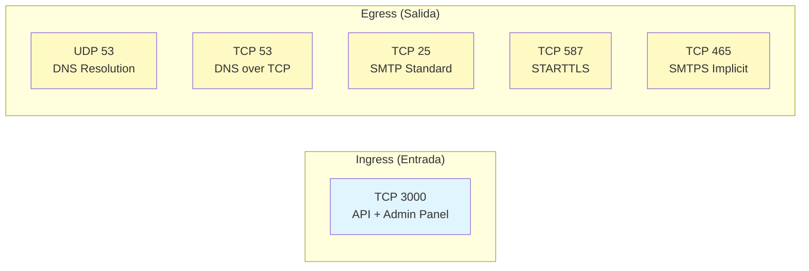
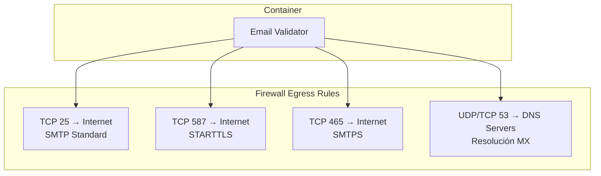
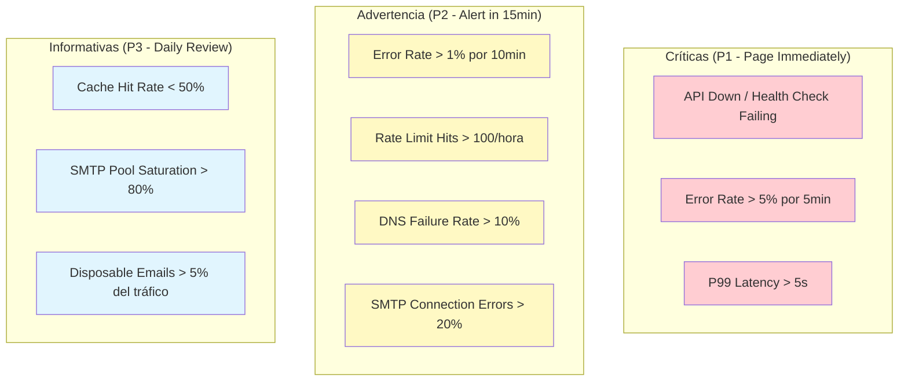
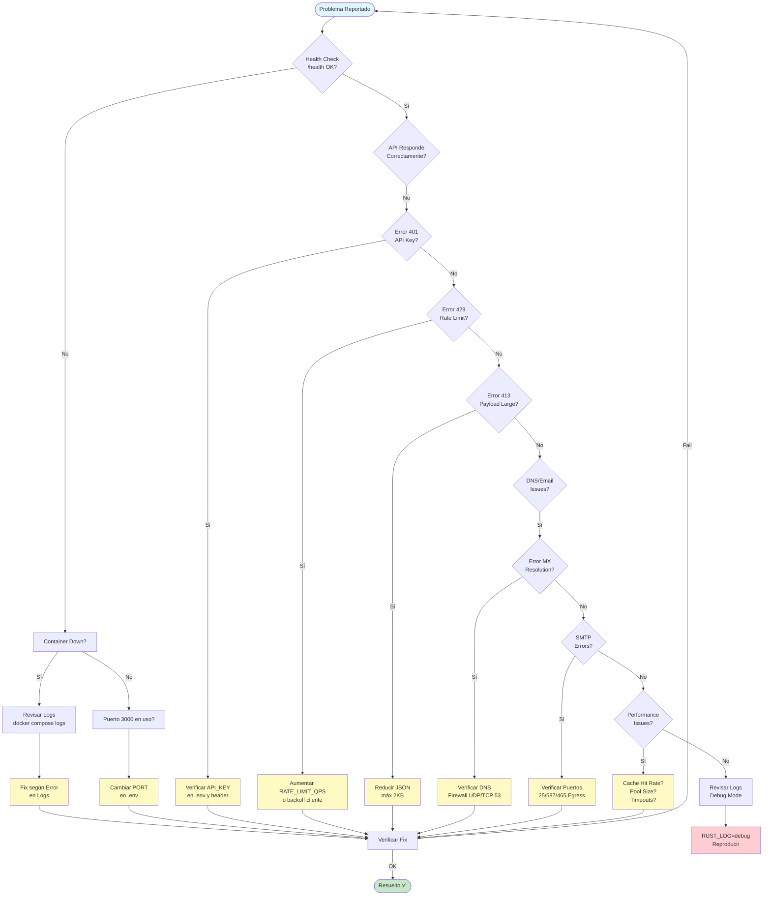

# 🐳 Guía de Despliegue y Operación - Email Validator API v2.0.0

> **Documentación completa para desplegar, configurar, operar y solucionar problemas del servicio en producción.**

---

## 📑 Índice

1. [Requisitos Previos](#-requisitos-previos)
2. [Despliegue con Docker Compose](#-despliegue-con-docker-compose)
3. [Despliegue en Kubernetes](#-despliegue-en-kubernetes)
4. [Configuración de Variables de Entorno](#-configuración-de-variables-de-entorno)
5. [Configuración SMTP para Verificación Real](#-configuración-smtp-para-verificación-real)
6. [Reverse Proxy (nginx/Traefik)](#-reverse-proxy-nginxtraefik)
7. [Monitoreo y Alertas](#-monitoreo-y-alertas)
8. [Backup y Recuperación](#-backup-y-recuperación)
9. [Actualizaciones y Rollback](#-actualizaciones-y-rollback)
10. [Troubleshooting](#-troubleshooting)

---

## ✅ Requisitos Previos

### Sistema Operativo
- **Linux** (Ubuntu 20.04+, Debian 11+, RHEL 8+, Alpine 3.15+)
- **Windows** con WSL2 o Docker Desktop
- **macOS** con Docker Desktop

### Software Requerido
| Herramienta | Versión Mínima | Propósito |
|-------------|----------------|-----------|
| Docker Engine | 20.10+ | Runtime de contenedores |
| Docker Compose | 2.0+ | Orquestación local |
| curl | 7.68+ | Health checks y testing |
| jq | 1.6+ | Procesamiento JSON |
| openssl | 1.1.1+ | Generación certificados TLS |

### Recursos Mínimos
| Recurso | Mínimo | Recomendado (Producción) |
|---------|--------|--------------------------|
| CPU | 0.5 vCPU | 2 vCPU |
| RAM | 128 MB | 512 MB |
| Disco | 500 MB | 2 GB |
| Red | Salida DNS (53) + SMTP (25/587/465) | Igual |

### Puertos de Firewall Requeridos



---

## 🐳 Despliegue con Docker Compose

### Estructura de Archivos

```
email-validator/
├── docker-compose.yml
├── Dockerfile
├── .env                    # ← Crear desde .env.example
├── .env.example
├── data/                   # ← Persistencia (auto-creado)
│   ├── keys.json           # API Keys
│   └── admin_auth.json     # Admin credentials
└── docs/
```

### 1. Preparar Configuración

```bash
# Clonar repositorio
git clone https://github.com/darzkrow/MX-Checker.git
cd MX-Checker

# Crear archivo de configuración
cp .env.example .env

# Editar configuración (OBLIGATORIO en producción)
nano .env
```

### 2. Variables Críticas para Producción

```bash
# .env - CONFIGURACIÓN MÍNIMA PRODUCCIÓN
API_KEY=sk-prod-xxxxxxxxxxxxxxxxxxxxxxxx  # ¡CAMBIAR! Mínimo 32 chars aleatorios
ADMIN_USER=admin                          # Usuario panel admin
ADMIN_PASSWORD=SuperSecurePass123!        # ¡CAMBIAR! Se hashea auto
ALLOWED_ORIGINS=https://tudominio.com,https://app.tudominio.com
RATE_LIMIT_QPS=50                         # Ajustar según capacidad
RUST_LOG=info                             # info|warn|error

# SMTP (Opcional - ver sección SMTP)
SMTP_VERIFICATION_ENABLED=false
```

### 3. Generar API Key Segura

```bash
# Opción 1: OpenSSL (recomendado)
openssl rand -hex 32
# Ejemplo: a1b2c3d4e5f678901234567890abcdef1234567890abcdef1234567890abcd

# Opción 2: Rust (si tienes cargo instalado)
cargo run --example generate_key 2>/dev/null || echo "sk-$(openssl rand -hex 32)"
```

### 4. Desplegar

```bash
# Construir y levantar en background
docker compose up -d --build

# Ver logs en tiempo real
docker compose logs -f email-validator

# Verificar estado
docker compose ps
# NAME                    STATUS
# email-validator-api     Up (healthy)
```

### 5. Verificar Despliegue

```bash
# Health check
curl -f http://localhost:3000/health
# ✅ Email Validator API is running

# Validar email (reemplazar API_KEY)
curl -X POST http://localhost:3000/api/v1/validate-email \
  -H "Content-Type: application/json" \
  -H "X-API-Key: TU_API_KEY_AQUI" \
  -d '{"email":"test@gmail.com"}' | jq .

# Panel admin
# Abrir: http://localhost:3000/admin
# Usuario: ADMIN_USER | Password: ADMIN_PASSWORD
```

---

## ☸️ Despliegue en Kubernetes

### Namespace y ConfigMap

```yaml
# k8s/namespace.yaml
apiVersion: v1
kind: Namespace
metadata:
  name: email-validator
  labels:
    app: email-validator
```

```yaml
# k8s/configmap.yaml
apiVersion: v1
kind: ConfigMap
metadata:
  name: email-validator-config
  namespace: email-validator
data:
  ALLOWED_ORIGINS: "https://app.example.com"
  PORT: "3000"
  RATE_LIMIT_QPS: "100"
  RUST_LOG: "info"
  SMTP_VERIFICATION_ENABLED: "true"
  SMTP_CONNECT_TIMEOUT_SECS: "10"
  SMTP_MAX_RETRIES: "2"
```

### Secret (API Keys y Credenciales)

```yaml
# k8s/secret.yaml
apiVersion: v1
kind: Secret
metadata:
  name: email-validator-secrets
  namespace: email-validator
type: Opaque
stringData:
  API_KEY: "sk-prod-xxxxxxxxxxxxxxxxxxxxxxxx"
  ADMIN_USER: "admin"
  ADMIN_PASSWORD: "SuperSecurePass123!"
  # SMTP (opcional)
  SMTP_HELO_DOMAIN: "email-validator.example.com"
```

### Deployment

```yaml
# k8s/deployment.yaml
apiVersion: apps/v1
kind: Deployment
metadata:
  name: email-validator
  namespace: email-validator
  labels:
    app: email-validator
spec:
  replicas: 3
  selector:
    matchLabels:
      app: email-validator
  template:
    metadata:
      labels:
        app: email-validator
      annotations:
        prometheus.io/scrape: "true"
        prometheus.io/port: "3000"
        prometheus.io/path: "/metrics"
    spec:
      securityContext:
        runAsUser: 1000
        runAsGroup: 1000
        fsGroup: 1000
        runAsNonRoot: true
      containers:
      - name: email-validator
        image: darzkrow/email-validator:v2.0.0
        imagePullPolicy: IfNotPresent
        ports:
        - containerPort: 3000
          name: http
        envFrom:
        - configMapRef:
            name: email-validator-config
        - secretRef:
            name: email-validator-secrets
        resources:
          requests:
            cpu: "250m"
            memory: "256Mi"
          limits:
            cpu: "1000m"
            memory: "512Mi"
        livenessProbe:
          httpGet:
            path: /health
            port: 3000
          initialDelaySeconds: 10
          periodSeconds: 30
          timeoutSeconds: 10
          failureThreshold: 3
        readinessProbe:
          httpGet:
            path: /health
            port: 3000
          initialDelaySeconds: 5
          periodSeconds: 10
          timeoutSeconds: 5
          failureThreshold: 3
        volumeMounts:
        - name: data
          mountPath: /app/data
      volumes:
      - name: data
        persistentVolumeClaim:
          claimName: email-validator-pvc
```

### Service e Ingress

```yaml
# k8s/service.yaml
apiVersion: v1
kind: Service
metadata:
  name: email-validator
  namespace: email-validator
spec:
  selector:
    app: email-validator
  ports:
  - port: 80
    targetPort: 3000
    protocol: TCP
    name: http
  type: ClusterIP
```

```yaml
# k8s/ingress.yaml
apiVersion: networking.k8s.io/v1
kind: Ingress
metadata:
  name: email-validator
  namespace: email-validator
  annotations:
    cert-manager.io/cluster-issuer: "letsencrypt-prod"
    nginx.ingress.kubernetes.io/rate-limit: "100"
    nginx.ingress.kubernetes.io/proxy-body-size: "2k"
spec:
  ingressClassName: nginx
  tls:
  - hosts:
    - api.example.com
    secretName: email-validator-tls
  rules:
  - host: api.example.com
    http:
      paths:
      - path: /
        pathType: Prefix
        backend:
          service:
            name: email-validator
            port:
              number: 80
```

### PersistentVolumeClaim

```yaml
# k8s/pvc.yaml
apiVersion: v1
kind: PersistentVolumeClaim
metadata:
  name: email-validator-pvc
  namespace: email-validator
spec:
  accessModes:
    - ReadWriteOnce
  resources:
    requests:
      storage: 1Gi
  storageClassName: standard
```

### Aplicar Manifiestos

```bash
# Aplicar todo
kubectl apply -f k8s/

# Verificar
kubectl get pods -n email-validator
kubectl get svc -n email-validator
kubectl get ingress -n email-validator

# Logs
kubectl logs -n email-validator -l app=email-validator -f
```

---

## ⚙️ Configuración de Variables de Entorno

### Referencia Completa

| Variable | Descripción | Default | Requerido | Ejemplo |
|----------|-------------|---------|-----------|---------|
| **API_KEY** | Clave maestra para autenticación | - | ✅ | `sk-prod-a1b2c3d4...` |
| **ADMIN_USER** | Usuario panel admin | `Administrator` | ❌ | `admin` |
| **ADMIN_PASSWORD** | Password admin (se hashea) | `admin12345` | ❌ | `SecurePass123!` |
| **ALLOWED_ORIGINS** | CORS origins (coma-separated) | `http://localhost:3000,http://localhost:5173` | ❌ | `https://app.example.com` |
| **PORT** | Puerto HTTP | `3000` | ❌ | `8080` |
| **RATE_LIMIT_QPS** | Requests/seg por IP | `10` | ❌ | `100` |
| **RUST_LOG** | Nivel logging | `info` | ❌ | `debug\|info\|warn\|error` |
| **DATA_DIR** | Directorio persistencia | `./data` | ❌ | `/app/data` |

### Variables SMTP (v2.0)

| Variable | Descripción | Default | Requerido |
|----------|-------------|---------|-----------|
| **SMTP_VERIFICATION_ENABLED** | Activar verificación RCPT TO | `false` | ❌ |
| **SMTP_CONNECT_TIMEOUT_SECS** | Timeout conexión TCP | `10` | ❌ |
| **SMTP_COMMAND_TIMEOUT_SECS** | Timeout comandos SMTP | `10` | ❌ |
| **SMTP_TOTAL_TIMEOUT_SECS** | Timeout total verificación | `30` | ❌ |
| **SMTP_MAX_RETRIES** | Reintentos en 4xx | `2` | ❌ |
| **SMTP_RETRY_BACKOFF_SECS** | Backoff base (exponencial) | `5` | ❌ |
| **SMTP_PRIMARY_PORT** | Puerto SMTP principal | `25` | ❌ |
| **SMTP_SUBMISSION_PORT** | Puerto Submission (STARTTLS) | `587` | ❌ |
| **SMTP_SMTPS_PORT** | Puerto SMTPS implícito | `465` | ❌ |
| **SMTP_HELO_DOMAIN** | Dominio para EHLO | `email-validator.local` | ❌ |
| **SMTP_MAIL_FROM** | Remitente MAIL FROM | `""` (null sender) | ❌ |
| **SMTP_DANGER_ACCEPT_INVALID_CERTS** | Aceptar certs inválidos (solo test) | `false` | ❌ |
| **SMTP_ENABLE_CATCH_ALL_DETECTION** | Detectar dominios catch-all | `true` | ❌ |

### Perfiles de Configuración

```bash
# Desarrollo
RUST_LOG=debug
RATE_LIMIT_QPS=50
SMTP_VERIFICATION_ENABLED=false

# Staging
RUST_LOG=info
RATE_LIMIT_QPS=50
SMTP_VERIFICATION_ENABLED=true
SMTP_DANGER_ACCEPT_INVALID_CERTS=true

# Producción
RUST_LOG=warn
RATE_LIMIT_QPS=100
SMTP_VERIFICATION_ENABLED=true
SMTP_CONNECT_TIMEOUT_SECS=15
SMTP_COMMAND_TIMEOUT_SECS=15
SMTP_TOTAL_TIMEOUT_SECS=45
SMTP_MAX_RETRIES=3
```

---

## 📧 Configuración SMTP para Verificación Real

### Habilitar Verificación SMTP

```bash
# .env
SMTP_VERIFICATION_ENABLED=true
SMTP_HELO_DOMAIN=email-validator.tuempresa.com
SMTP_MAIL_FROM=noreply@tuempresa.com
```

### Requisitos de Red Saliente



### Configuración por Proveedor Cloud

#### AWS (EC2/ECS/Fargate)
```bash
# Security Group Egress
# Type: Custom TCP | Port: 25,587,465 | Destination: 0.0.0.0/0
# Type: Custom UDP/TCP | Port: 53 | Destination: 0.0.0.0/0

# Nota: AWS bloquea puerto 25 por defecto
# Usar puerto 587 (STARTTLS) o solicitar除限制
# AWS SES: usar smtp.email.us-east-1.amazonaws.com:587
```

#### GCP (Cloud Run/Compute Engine)
```bash
# VPC Firewall Egress
# Permitir TCP 25,587,465, UDP/TCP 53
# Cloud Run: configurar VPC Connector
```

#### Azure (Container Apps/VMs)
```bash
# NSG Outbound Rules
# Permitir puertos 25,587,465,53
# Azure bloquea 25 por defecto → usar 587
```

### Pruebas de Conectividad SMTP

```bash
# Desde el contenedor/host
# Puerto 25
nc -zv mx.gmail.com 25
# O con timeout
timeout 10 bash -c "cat < /dev/null > /dev/tcp/mx.gmail.com/25"

# Puerto 587 (STARTTLS)
openssl s_client -connect mx.gmail.com:587 -starttls smtp -quiet

# Puerto 465 (SMTPS)
openssl s_client -connect mx.gmail.com:465 -quiet

# Verificar resolución MX
dig MX gmail.com +short
# 5 gmail-smtp-in.l.google.com.
# 10 alt1.gmail-smtp-in.l.google.com.
# ...
```

### Troubleshooting SMTP Común

| Error | Causa | Solución |
|-------|-------|----------|
| `Connection timeout` | Firewall bloquea puerto | Abrir puertos 25/587/465 en SG/Firewall |
| `Connection refused` | Puerto cerrado en destino | Verificar MX válido, probar 587/465 |
| `TLS handshake failed` | Certificado inválido | `SMTP_DANGER_ACCEPT_INVALID_CERTS=true` (solo test) |
| `550 Relay access denied` | IP en lista negra | Usar IP dedicada / Relay SMTP / Solicitar delisting |
| `421 Too many connections` | Rate limiting destino | Reducir `RATE_LIMIT_QPS`, aumentar backoff |
| `DNS resolution failed` | DNS no accesible | Verificar UDP/TCP 53, configurar DNS servers |

---

## 🔀 Reverse Proxy (nginx/Traefik)

### nginx Configuration

```nginx
# /etc/nginx/sites-available/email-validator
upstream email_validator {
    least_conn;
    server 127.0.0.1:3000 max_fails=3 fail_timeout=30s;
    keepalive 32;
}

server {
    listen 80;
    listen [::]:80;
    server_name api.tuempresa.com;
    
    # Redirect HTTP to HTTPS
    return 301 https://$server_name$request_uri;
}

server {
    listen 443 ssl http2;
    listen [::]:443 ssl http2;
    server_name api.tuempresa.com;
    
    # SSL Certificates (Let's Encrypt / Certbot)
    ssl_certificate /etc/letsencrypt/live/api.tuempresa.com/fullchain.pem;
    ssl_certificate_key /etc/letsencrypt/live/api.tuempresa.com/privkey.pem;
    
    # SSL Security
    ssl_protocols TLSv1.2 TLSv1.3;
    ssl_ciphers ECDHE-RSA-AES256-GCM-SHA512:DHE-RSA-AES256-GCM-SHA512;
    ssl_prefer_server_ciphers off;
    ssl_session_cache shared:SSL:10m;
    ssl_session_timeout 10m;
    
    # Security Headers
    add_header Strict-Transport-Security "max-age=31536000; includeSubDomains" always;
    add_header X-Frame-Options DENY always;
    add_header X-Content-Type-Options nosniff always;
    add_header X-XSS-Protection "1; mode=block" always;
    add_header Referrer-Policy "strict-origin-when-cross-origin" always;
    
    # Rate Limiting (adicional al de la app)
    limit_req_zone $binary_remote_addr zone=api_limit:10m rate=100r/s;
    limit_req zone=api_limit burst=20 nodelay;
    
    # Proxy Settings
    location / {
        proxy_pass http://email_validator;
        proxy_http_version 1.1;
        proxy_set_header Host $host;
        proxy_set_header X-Real-IP $remote_addr;
        proxy_set_header X-Forwarded-For $proxy_add_x_forwarded_for;
        proxy_set_header X-Forwarded-Proto $scheme;
        proxy_set_header X-Forwarded-Host $host;
        proxy_set_header X-Forwarded-Port $server_port;
        
        # Timeouts
        proxy_connect_timeout 10s;
        proxy_send_timeout 60s;
        proxy_read_timeout 60s;
        
        # Buffering
        proxy_buffering on;
        proxy_buffer_size 4k;
        proxy_buffers 8 4k;
        
        # WebSocket support (si se usa)
        proxy_set_header Upgrade $http_upgrade;
        proxy_set_header Connection "upgrade";
    }
    
    # Admin panel - restrict to specific IPs
    location /admin {
        allow 10.0.0.0/8;      # RFC1918
        allow 172.16.0.0/12;
        allow 192.168.0.0/16;
        allow 203.0.113.0/24;  # Tu IP pública office
        deny all;
        
        proxy_pass http://email_validator;
        # ... mismos headers que arriba
    }
    
    # Health check - no rate limit
    location /health {
        proxy_pass http://email_validator;
        access_log off;
    }
}
```

### Traefik Configuration (Docker Labels)

```yaml
# docker-compose.yml con Traefik
services:
  email-validator:
    # ... configuración base
    labels:
      - "traefik.enable=true"
      - "traefik.http.routers.email-validator.rule=Host(`api.tuempresa.com`)"
      - "traefik.http.routers.email-validator.entrypoints=websecure"
      - "traefik.http.routers.email-validator.tls.certresolver=letsencrypt"
      - "traefik.http.routers.email-validator.middlewares=email-validator-ratelimit,email-validator-headers"
      - "traefik.http.middlewares.email-validator-ratelimit.ratelimit.average=100"
      - "traefik.http.middlewares.email-validator-ratelimit.ratelimit.burst=20"
      - "traefik.http.middlewares.email-validator-headers.headers.ststransportsecurity=true"
      - "traefik.http.middlewares.email-validator-headers.headers.stsincludesubdomains=true"
      - "traefik.http.middlewares.email-validator-headers.headers.contenttypenosniff=true"
      - "traefik.http.middlewares.email-validator-headers.headers.frameDeny=true"
      - "traefik.http.services.email-validator.loadbalancer.server.port=3000"
      
      # Admin panel con IP allowlist
      - "traefik.http.routers.email-validator-admin.rule=Host(`api.tuempresa.com`) && PathPrefix(`/admin`)"
      - "traefik.http.routers.email-validator-admin.entrypoints=websecure"
      - "traefik.http.routers.email-validator-admin.tls.certresolver=letsencrypt"
      - "traefik.http.routers.email-validator-admin.middlewares=email-validator-ipallowlist"
      - "traefik.http.middlewares.email-validator-ipallowlist.ipallowlist.sourcerange=10.0.0.0/8,172.16.0.0/12,192.168.0.0/16,203.0.113.0/24"
    networks:
      - traefik-net
      - email-validator-net

networks:
  traefik-net:
    external: true
  email-validator-net:
    driver: bridge
```

---

## 📊 Monitoreo y Alertas

### Health Checks

```bash
# Liveness (Kubernetes/Docker)
curl -f http://localhost:3000/health

# Readiness (Kubernetes)
curl -f http://localhost:3000/health

# Con autenticación (si se protege)
curl -f -H "X-API-Key: $API_KEY" http://localhost:3000/health
```

### Métricas Clave para Alertas



### Prometheus Metrics (Futuro)

```yaml
# .prometheus.yml (cuando se implemente /metrics endpoint)
- job_name: 'email-validator'
  static_configs:
    - targets: ['email-validator:3000']
  metrics_path: '/metrics'
  scrape_interval: 30s
```

### Grafana Dashboard Queries

```promql
# Request Rate
rate(email_validator_total_requests[5m])

# Error Rate
rate(email_validator_auth_failures[5m]) 
+ rate(email_validator_rate_limit_hits[5m])
+ rate(email_validator_dns_errors[5m])
+ rate(email_validator_syntax_errors[5m])

# Latency P99
histogram_quantile(0.99, rate(email_validator_latency_bucket[5m]))

# SMTP Success Rate
rate(email_validator_smtp_deliverable[5m]) 
/ rate(email_validator_smtp_verifications_total[5m])

# Cache Hit Rate
rate(email_validator_mx_cache_hits[5m]) 
/ (rate(email_validator_mx_cache_hits[5m]) + rate(email_validator_mx_cache_misses[5m]))

# Top Problematic Domains
topk(10, email_validator_top_problematic_domains_occurrences)
```

---

## 💾 Backup y Recuperación

### Datos a Respaldar

```mermaid
graph TB
    subgraph "Volumen /app/data"
        Keys[keys.json<br/>API Keys + Usage]
        Auth[admin_auth.json<br/>Admin Credentials Hash]
        Logs[logs/ (opcional)<br/>Archived logs]
    end
    
    subgraph "Backup Strategy"
        Daily[Daily Snapshot<br/>00:00 UTC]
        Weekly[Weekly Full<br/>Domingo 02:00]
        Monthly[Monthly Archive<br/>1er día mes]
    end
    
    Keys --> Daily
    Auth --> Daily
    Logs --> Weekly
```

### Script de Backup

```bash
#!/bin/bash
# backup-email-validator.sh
# Ejecutar via cron: 0 0 * * * /path/backup-email-validator.sh

set -euo pipefail

BACKUP_DIR="/backups/email-validator"
DATE=$(date +%Y%m%d_%H%M%S)
RETENTION_DAYS=30

# Crear directorio
mkdir -p "$BACKUP_DIR"

# Backup datos
docker run --rm \
  -v email-validator_data:/data:ro \
  -v "$BACKUP_DIR":/backup \
  alpine tar czf "/backup/email-validator_${DATE}.tar.gz" -C /data .

# Verificar backup
if [ -f "$BACKUP_DIR/email-validator_${DATE}.tar.gz" ]; then
    echo "✅ Backup completado: email-validator_${DATE}.tar.gz"
    
    # Limpiar backups antiguos
    find "$BACKUP_DIR" -name "email-validator_*.tar.gz" -mtime +$RETENTION_DAYS -delete
    echo "🧹 Backups antiguos (>${RETENTION_DAYS} días) eliminados"
else
    echo "❌ ERROR: Backup falló"
    exit 1
fi
```

### Restauración

```bash
#!/bin/bash
# restore-email-validator.sh <backup_file.tar.gz>

set -euo pipefail

BACKUP_FILE="${1:-}"
if [ -z "$BACKUP_FILE" ] || [ ! -f "$BACKUP_FILE" ]; then
    echo "Uso: $0 <backup_file.tar.gz>"
    exit 1
fi

echo "⚠️  Esto sobrescribirá los datos actuales. Continuar? (y/N)"
read -r CONFIRM
if [[ ! "$CONFIRM" =~ ^[Yy]$ ]]; then
    echo "Cancelado"
    exit 0
fi

# Detener servicio
docker compose stop email-validator

# Restaurar
docker run --rm \
  -v email-validator_data:/data \
  -v "$(dirname "$BACKUP_FILE")":/backup \
  alpine tar xzf "/backup/$(basename "$BACKUP_FILE")" -C /data

# Reiniciar
docker compose start email-validator

echo "✅ Restauración completada"
```

---

## 🔄 Actualizaciones y Rollback

### Estrategia de Despliegue

```mermaid
graph LR
    subgraph "Blue-Green Deployment"
        Blue[Blue v2.0.0<br/>Active]
        Green[Green v2.1.0<br/>Staging]
    end
    
    subgraph "Canary"
        Canary[Canary 10%<br/>v2.1.0]
        Monitor[Monitor Metrics<br/>5 min]
    end
    
    Blue -->|Switch| Green
    Blue -->|Canary| Canary
    Canary -->|OK| Green
    Canary -->|Fail| Rollback[Rollback to Blue]
```

### Procedimiento de Actualización

```bash
#!/bin/bash
# update-email-validator.sh <new_version>

set -euo pipefail

NEW_VERSION="${1:-latest}"
BACKUP_TAG="pre-update-$(date +%Y%m%d-%H%M%S)"

echo "🔄 Actualizando a $NEW_VERSION..."

# 1. Backup pre-update
docker commit email-validator-api "email-validator-backup:$BACKUP_TAG"
echo "✅ Backup tag: $BACKUP_TAG"

# 2. Pull nueva imagen
docker pull "darzkrow/email-validator:$NEW_VERSION"

# 3. Actualizar docker-compose.yml si cambia versión
sed -i "s|image: darzkrow/email-validator:.*|image: darzkrow/email-validator:$NEW_VERSION|" docker-compose.yml

# 4. Rolling update (zero-downtime con replicas)
docker compose up -d --no-deps email-validator

# 5. Health check
for i in {1..30}; do
    if curl -sf http://localhost:3000/health >/dev/null; then
        echo "✅ Servicio saludable"
        break
    fi
    sleep 2
done

# 6. Verificar métricas
sleep 10
curl -s -H "X-API-Key: $API_KEY" http://localhost:3000/api/v1/validate-email \
  -d '{"email":"test@gmail.com"}' | jq .is_deliverable

echo "✅ Actualización completada"
```

### Rollback Rápido

```bash
#!/bin/bash
# rollback-email-validator.sh <backup_tag>

set -euo pipefail

BACKUP_TAG="${1:-}"
if [ -z "$BACKUP_TAG" ]; then
    echo "Uso: $0 <backup_tag>"
    echo "Tags disponibles:"
    docker images --format "table {{.Repository}}:{{.Tag}}" | grep email-validator-backup
    exit 1
fi

echo "🔙 Rollback a $BACKUP_TAG..."

# Detener actual
docker compose stop email-validator

# Restaurar imagen
docker tag "email-validator-backup:$BACKUP_TAG" "darzkrow/email-validator:current"

# Iniciar con imagen anterior
docker compose up -d email-validator

# Verificar
for i in {1..30}; do
    if curl -sf http://localhost:3000/health >/dev/null; then
        echo "✅ Rollback completado"
        exit 0
    fi
    sleep 2
done

echo "❌ Rollback falló - revisar logs"
docker compose logs email-validator
exit 1
```

---

## 🔧 Troubleshooting

### Diagnostic Flowchart



### Problemas Comunes y Soluciones

| Síntoma | Causa Probable | Solución |
|---------|----------------|----------|
| **Container reinicia constantemente** | OOM Kill / Memoria insuficiente | Aumentar `mem_limit` en docker-compose, revisar `RUST_LOG=debug` no esté en prod |
| **Health check falla** | App no inicia / Puerto ocupado | `docker compose logs email-validator`, verificar `PORT` libre |
| **Error 401 en todos los requests** | `API_KEY` no coincide | Verificar `.env` y header `X-API-Key` exacto |
| **Error 429 inmediato** | Rate limit muy bajo | Aumentar `RATE_LIMIT_QPS`, verificar `X-Forwarded-For` correcto |
| **Latencia alta (>2s)** | DNS lento / SMTP timeout | Verificar conectividad DNS/SMTP, aumentar timeouts |
| **Error 502 DNS** | DNS servers inaccesibles | Verificar UDP/TCP 53 salida, configurar DNS servers válidos |
| **SMTP Connection Error** | Firewall bloquea puertos | Abrir 25/587/465 salida, probar con `nc`/`openssl` |
| **Cache miss rate alto** | TTL muy bajo / dominios únicos | Aumentar `MX_CACHE_TTL_SECS` (default 3600) |
| **Pool conexiones saturado** | Muchas requests concurrentes | Aumentar `SMTP_CONNECTION_POOL_SIZE` |
| **Admin panel 403** | IP no en allowlist | Configurar `ALLOWED_ORIGINS` o IP allowlist en proxy |

### Logs de Diagnóstico

```bash
# Ver logs en tiempo real
docker compose logs -f email-validator

# Últimas 100 líneas
docker compose logs --tail=100 email-validator

# Filtrar por nivel
docker compose logs email-validator 2>&1 | grep -i error
docker compose logs email-validator 2>&1 | grep -i warn

# Exportar logs para análisis
docker compose logs --since=24h email-validator > logs_$(date +%Y%m%d).txt

# Debug mode (temporal)
docker compose exec email-validator sh -c 'RUST_LOG=debug ./email-validator'
```

### Métricas de Debugging

```bash
# Obtener métricas actuales (requiere auth admin)
curl -u admin:password http://localhost:3000/api/v1/admin/metrics | jq .

# Ver dominios problemáticos
curl -u admin:password http://localhost:3000/api/v1/admin/metrics | jq .top_problematic_domains

# Ver logs recientes
curl -u admin:password http://localhost:3000/api/v1/admin/logs | jq .

# Test de validación completa
curl -X POST http://localhost:3000/api/v1/validate-email \
  -H "Content-Type: application/json" \
  -H "X-API-Key: $API_KEY" \
  -d '{"email":"test@gmail.com"}' | jq .
```

---

## 📋 Checklist de Producción

### Pre-Deploy
- [ ] `API_KEY` generada y segura (32+ chars aleatorios)
- [ ] `ADMIN_PASSWORD` cambiado y fuerte
- [ ] `ALLOWED_ORIGINS` configurado para dominios reales
- [ ] `RATE_LIMIT_QPS` ajustado a capacidad esperada
- [ ] `RUST_LOG=warn` o `error` (no debug)
- [ ] Variables SMTP configuradas si se usa verificación real
- [ ] Firewall Egress: puertos 25, 587, 465, 53 abiertos
- [ ] Reverse proxy (nginx/Traefik) configurado con TLS
- [ ] Health checks configurados en orquestador
- [ ] Backup automático configurado y probado
- [ ] Alertas configuradas (error rate, latencia, SMTP failures)

### Post-Deploy
- [ ] Health check responde 200
- [ ] Validación email de prueba exitosa
- [ ] Panel admin accesible y funcional
- [ ] Métricas expuestas y scrapeadas
- [ ] Alertas disparando correctamente en staging
- [ ] Documentación de runbooks actualizada
- [ ] Runbook de rollback probado

### Mantenimiento Continuo
- [ ] Rotar `API_KEY` cada 90 días
- [ ] Revisar `top_problematic_domains` semanalmente
- [ ] Verificar backup/restore mensualmente
- [ ] Actualizar imagen base Docker mensualmente
- [ ] Revisar rate limits y ajustar según tráfico
- [ ] Monitorear IP reputation si usa SMTP real

---

## 📞 Soporte y Escalación

### Niveles de Soporte

| Nivel | Tiempo Respuesta | Canal | Ejemplos |
|-------|------------------|-------|----------|
| **P1 - Crítico** | 15 min | Teléfono + Slack #oncall | Servicio caído, data loss, security breach |
| **P2 - Alto** | 1 hora | Slack #oncall + Email | Degradación performance, error rate >5% |
| **P3 - Medio** | 4 horas | Email + Ticket | Bug no crítico, feature request |
| **P4 - Bajo** | 1 día hábil | Ticket | Documentación, mejora futura |

### Contactos de Escalación

```
┌─────────────────────────────────────────────┐
│  ESCALATION CONTACTS                        │
├─────────────────────────────────────────────┤
│  Primary On-Call:     +1-XXX-XXX-XXXX      │
│  Secondary On-Call:   +1-XXX-XXX-XXXX      │
│  Engineering Lead:    lead@empresa.com     │
│  Security Team:       security@empresa.com │
│  Infra Team:          infra@empresa.com    │
└─────────────────────────────────────────────┘
```

### Runbooks de Incidente Comunes

| Incidente | Runbook | Owner |
|-----------|---------|-------|
| Servicio caído | `runbooks/service-down.md` | On-Call |
| Latencia alta | `runbooks/high-latency.md` | On-Call |
| Error rate spike | `runbooks/error-spike.md` | On-Call |
| SMTP failures | `runbooks/smtp-failures.md` | Infra |
| DNS resolution fails | `runbooks/dns-failures.md` | Infra |
| Rate limit abuse | `runbooks/rate-limit-abuse.md` | Security |
| API Key comprometida | `runbooks/api-key-compromise.md` | Security |
| Certificado TLS expirado | `runbooks/tls-cert-expiry.md` | Infra |

---

*Guía de Despliegue v2.0.0 - Última actualización: 19 Noviembre 2026*