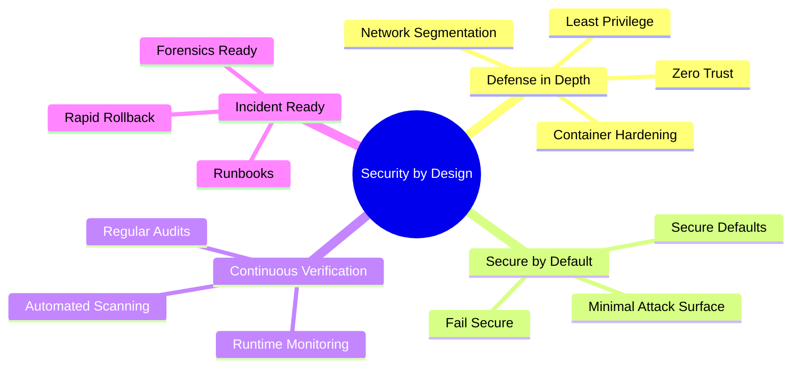
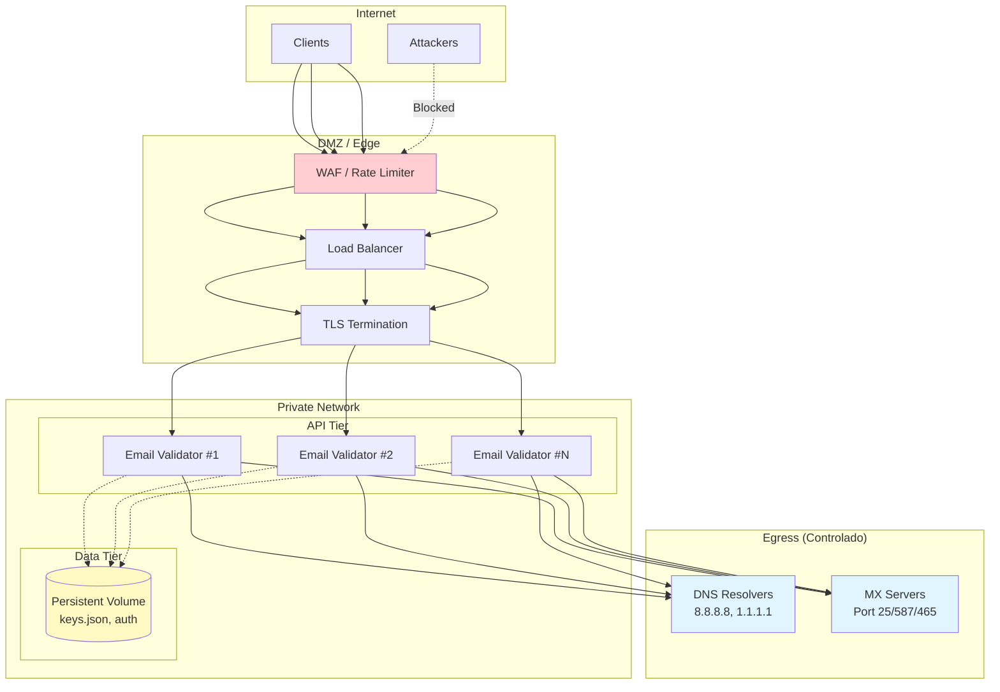
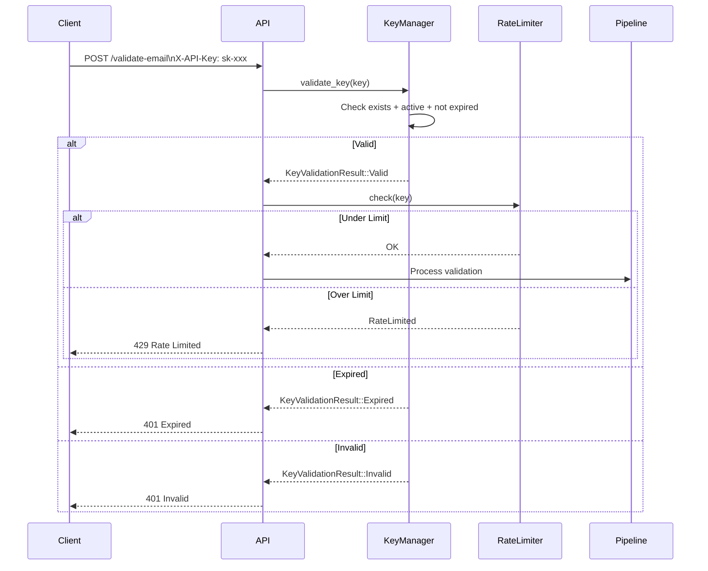
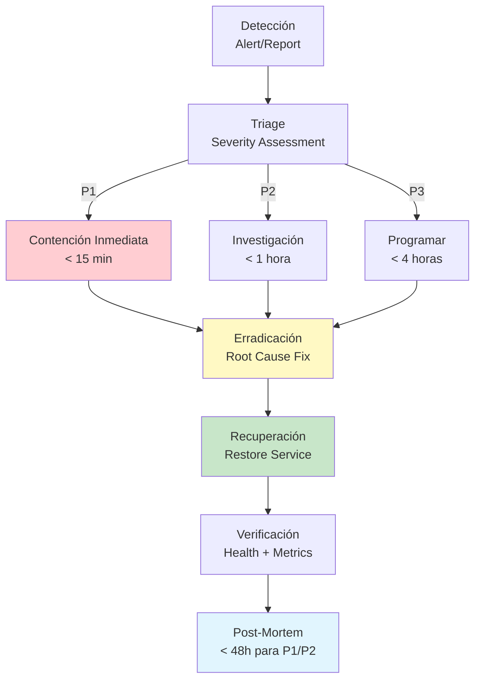

# 🛡️ Guía de Hardening de Seguridad - Email Validator API v2.0.0

> **Configuración segura, mejores prácticas, cumplimiento normativo y procedimientos de respuesta a incidentes.**

---

## 📑 Índice

1. [Principios de Seguridad](#-principios-de-seguridad)
2. [Hardening de Contenedor](#-hardening-de-contenedor)
3. [Seguridad de Red](#-seguridad-de-red)
4. [Gestión de Secretos](#-gestión-de-secretos)
5. [Autenticación y Autorización](#-autenticación-y-autorización)
6. [Validación de Entrada](#-validación-de-entrada)
7. [Logging y Auditoría](#-logging-y-auditoría)
8. [Cumplimiento Normativo](#-cumplimiento-normativo)
9. [Respuesta a Incidentes](#-respuesta-a-incidentes)
10. [Checklist de Hardening](#-checklist-de-hardening)

---

## 🎯 Principios de Seguridad



### Modelo de Amenazas (STRIDE)

| Categoría | Amenaza | Mitigación |
|-----------|---------|------------|
| **Spoofing** | Suplantación API Key | API Key rotación, expiración, rate limiting |
| **Tampering** | Modificación payload | Validación estricta 2KB, JSON schema |
| **Repudiation** | Negación de acciones | Audit logs inmutables, timestamps |
| **Information Disclosure** | Fuga datos sensibles | No logs de emails, headers sanitizados |
| **Denial of Service** | Agotamiento recursos | Rate limiting, timeouts, body limits |
| **Elevation of Privilege** | Acceso admin no autorizado | Basic Auth + salted hash, IP allowlist |

---

## 🐳 Hardening de Contenedor

### Dockerfile Seguro (Multi-stage)

```dockerfile
# ==================== BUILD STAGE ====================
FROM rust:1.78-slim AS builder

# Usuario no-root para build
RUN groupadd -r builder && useradd -r -g builder builder

# Dependencias mínimas
RUN apt-get update && apt-get install -y --no-install-recommends \
    pkg-config \
    libssl-dev \
    ca-certificates \
    && rm -rf /var/lib/apt/lists/*

WORKDIR /app
COPY --chown=builder:builder Cargo.toml Cargo.lock ./
COPY --chown=builder:builder packages ./packages

# Build como usuario no-root
USER builder
RUN cargo build --release --bin email-validator

# ==================== RUNTIME STAGE ====================
FROM gcr.io/distroless/cc-debian12:nonroot AS runtime

# Copiar solo binario necesario
COPY --from=builder /app/target/release/email-validator /email-validator

# Usuario nonroot (UID 65532 en distroless)
USER nonroot:nonroot

# Directorio datos con permisos correctos
# NOTA: En distroless no hay shell, usar volumen externo

EXPOSE 3001

# Health check nativo
HEALTHCHECK --interval=30s --timeout=10s --start-period=10s --retries=3 \
    CMD ["/email-validator", "--health-check"]

ENTRYPOINT ["/email-validator"]
```

### Configuración Docker Compose Hardened

```yaml
# docker-compose.prod.yml
version: '3.8'

services:
  email-validator:
    image: darzkrow/email-validator:v2.0.0
    container_name: email-validator-api
    restart: unless-stopped
    
    # Security hardening
    security_opt:
      - no-new-privileges:true
    cap_drop:
      - ALL
    cap_add:
      - NET_BIND_SERVICE  # Solo si puerto < 1024
    read_only: true
    tmpfs:
      - /tmp:noexec,nosuid,size=50m
      - /var/cache:noexec,nosuid,size=10m
    user: "1000:1000"
    
    # Resource limits
    deploy:
      resources:
        limits:
          cpus: '1.0'
          memory: 512M
        reservations:
          cpus: '0.25'
          memory: 128M
    
    # Network isolation
    networks:
      - email-validator-internal
    ports:
      - "127.0.0.1:3001:3001"  # Solo localhost, reverse proxy expone
    
    # Volumes
    volumes:
      - email-validator-data:/app/data:rw
      - ./config:/app/config:ro
    
    # Environment
    env_file:
      - .env.prod
    environment:
      - RUST_LOG=warn
      - DATA_DIR=/app/data
    
    # Health checks
    healthcheck:
      test: ["CMD", "/email-validator", "--health-check"]
      interval: 30s
      timeout: 10s
      retries: 3
      start_period: 15s
    
    # Logging
    logging:
      driver: "json-file"
      options:
        max-size: "10m"
        max-file: "5"
        labels: "service=email-validator"

  # Reverse proxy (nginx/traefik) en red separada
  reverse-proxy:
    image: nginx:alpine
    # ... config
    networks:
      - email-validator-internal
      - public

networks:
  email-validator-internal:
    driver: bridge
    internal: true  # Sin acceso internet directo
  public:
    driver: bridge

volumes:
  email-validator-data:
    driver: local
    driver_opts:
      type: none
      o: bind
      device: /opt/email-validator/data
```

### Security Options Explicados

| Opción | Propósito |
|--------|-----------|
| `no-new-privileges:true` | Previene escalación de privilegios via setuid/setgid |
| `cap_drop: ALL` | Elimina todas las capabilities Linux |
| `cap_add: NET_BIND_SERVICE` | Solo permite bind a puertos <1024 (si necesario) |
| `read_only: true` | Filesystem de solo lectura |
| `tmpfs` con `noexec,nosuid` | Directorios temporales sin ejecución |
| `user: "1000:1000"` | Usuario no-root |
| `internal: true` | Red sin acceso a Internet |

---

## 🌐 Seguridad de Red

### Arquitectura de Red Segura



### Políticas de Firewall

```bash
# === INGRESS (Entrada) ===
# Solo reverse proxy puede acceder al puerto 3001
iptables -A INPUT -p tcp -s 10.0.0.0/8 --dport 3001 -j ACCEPT  # Reverse proxy subnet
iptables -A INPUT -p tcp --dport 3001 -j DROP

# Admin panel - solo IPs de oficina
iptables -A INPUT -p tcp -s 203.0.113.0/24 --dport 3001 -m string --string "/admin" --algo bm -j ACCEPT
iptables -A INPUT -p tcp --dport 3001 -m string --string "/admin" --algo bm -j DROP

# Health checks - sin rate limit
iptables -A INPUT -p tcp --dport 3001 -m string --string "/health" --algo bm -j ACCEPT

# === EGRESS (Salida) ===
# DNS - solo resolvers autorizados
iptables -A OUTPUT -p udp -d 8.8.8.8 --dport 53 -j ACCEPT
iptables -A OUTPUT -p udp -d 1.1.1.1 --dport 53 -j ACCEPT
iptables -A OUTPUT -p tcp -d 8.8.8.8 --dport 53 -j ACCEPT
iptables -A OUTPUT -p tcp -d 1.1.1.1 --dport 53 -j ACCEPT
iptables -A OUTPUT -p udp --dport 53 -j DROP
iptables -A OUTPUT -p tcp --dport 53 -j DROP

# SMTP - solo puertos necesarios
iptables -A OUTPUT -p tcp --dport 25 -j ACCEPT
iptables -A OUTPUT -p tcp --dport 587 -j ACCEPT
iptables -A OUTPUT -p tcp --dport 465 -j ACCEPT

# Block todo otro tráfico saliente
iptables -A OUTPUT -j DROP
```

### TLS Configuration

```nginx
# nginx TLS Hardening
ssl_protocols TLSv1.2 TLSv1.3;
ssl_ciphers ECDHE-ECDSA-AES256-GCM-SHA384:ECDHE-RSA-AES256-GCM-SHA384:ECDHE-ECDSA-CHACHA20-POLY1305:ECDHE-RSA-CHACHA20-POLY1305;
ssl_prefer_server_ciphers off;
ssl_session_cache shared:SSL:10m;
ssl_session_timeout 10m;
ssl_session_tickets off;

# OCSP Stapling
ssl_stapling on;
ssl_stapling_verify on;
resolver 8.8.8.8 1.1.1.1 valid=300s;
resolver_timeout 5s;

# HSTS
add_header Strict-Transport-Security "max-age=31536000; includeSubDomains; preload" always;

# Certificate Transparency
ssl_ct on;
ssl_ct_static_scts /etc/nginx/ct-logs;
```

### Certificados

```bash
# Generar CSR con SANs
openssl req -new -newkey rsa:4096 -nodes -keyout email-validator.key \
  -out email-validator.csr -subj "/CN=api.tuempresa.com" \
  -addext "subjectAltName=DNS:api.tuempresa.com,DNS:admin.tuempresa.com"

# Renovación automática con certbot
certbot certonly --nginx -d api.tuempresa.com -d admin.tuempresa.com \
  --rsa-key-size 4096 --hsts --staple-ocsp --must-staple

# Verificar certificado
openssl x509 -in /etc/letsencrypt/live/api.tuempresa.com/fullchain.pem -text -noout
```

---

## 🔐 Gestión de Secretos

### Principios

```mermaid
graph LR
    subgraph "NO HACER"
        N1[Hardcodear en código]
        N2[Commitear .env a git]
        N3[Compartir por Slack/Email]
        N4[Usar misma key en todos envs]
    end
    
    subgraph "HACER"
        H1[Variables de entorno]
        H2[Secret Manager (Vault, AWS Secrets, etc.)]
        H3[Rotación automática]
        H4[Keys por ambiente]
        H5[Auditoría de acceso]
    end
    
    style N1 fill:#ffcdd2
    style N2 fill:#ffcdd2
    style N3 fill:#ffcdd2
    style N4 fill:#ffcdd2
    style H1 fill:#c8e6c9
    style H2 fill:#c8e6c9
    style H3 fill:#c8e6c9
    style H4 fill:#c8e6c9
    style H5 fill:#c8e6c9
```

### Implementación por Entorno

```bash
# === DESARROLLO ===
# .env.local (no commiteado, en .gitignore)
API_KEY=sk-dev-local-xxxx
RUST_LOG=debug

# === STAGING ===
# Inyectado via CI/CD desde Secret Manager
API_KEY=sk-stg-xxxx
SMTP_VERIFICATION_ENABLED=true
SMTP_DANGER_ACCEPT_INVALID_CERTS=true

# === PRODUCCIÓN ===
# Inyectado via CI/CD + Vault/AWS Secrets Manager
API_KEY=sk-prod-xxxx
SMTP_VERIFICATION_ENABLED=true
RUST_LOG=warn
```

### Rotación de API Keys

```bash
#!/bin/bash
# rotate-api-keys.sh - Ejecutar mensualmente via cron

set -euo pipefail

echo "🔄 Rotando API Keys..."

# 1. Generar nueva master key
NEW_MASTER_KEY="sk-prod-$(openssl rand -hex 32)"
echo "Nueva master key: $NEW_MASTER_KEY"

# 2. Actualizar en Secret Manager
# AWS: aws secretsmanager put-secret-value --secret-id email-validator/api-key --secret-string "$NEW_MASTER_KEY"
# Vault: kv put secret/email-validator api_key="$NEW_MASTER_KEY"

# 3. Actualizar .env en contenedores (rolling restart)
# docker compose up -d --no-deps email-validator

# 4. Invalidar keys antiguas (opcional)
# Via admin panel o API

# 5. Verificar
sleep 10
curl -H "X-API-Key: $NEW_MASTER_KEY" http://localhost:3001/health

echo "✅ Rotación completada"
```

### Hash de Contraseñas Admin

```rust
// En shared/src/lib.rs - AdminPasswordHash
// Ya implementado con SHA-256 + Salt aleatorio 16 chars

// Verificación timing-safe implementada:
// constant-time comparison via base64 decode + hash comparison

// Para mayor seguridad, considerar Argon2id:
// use argon2::{Argon2, PasswordHash, PasswordVerifier};
```

---

## 🔑 Autenticación y Autorización

### API Key Authentication



### Configuración de API Keys

```rust
// En key_manager.rs - KeyManager::create_key

// Configuración recomendada producción:
let key = key_manager.create_key(
    "production-api".to_string(),
    Some(90)  // Expira en 90 días
).await;

// Master key (del .env) - NUNCA expira
// Keys rotadas - expirar en 30-90 días
// Keys de desarrollo - expirar en 7 días
```

### Admin Panel Security

```bash
# Configuración nginx para /admin
location /admin {
    # IP Allowlist
    allow 10.0.0.0/8;
    allow 172.16.0.0/12;
    allow 192.168.0.0/16;
    allow 203.0.113.0/24;  # Oficina
    deny all;
    
    # Basic Auth adicional (defense in depth)
    auth_basic "Admin Panel";
    auth_basic_user_file /etc/nginx/.htpasswd_admin;
    
    # Rate limit estricto
    limit_req zone=admin_limit burst=5 nodelay;
    
    proxy_pass http://email_validator;
}

# Generar htpasswd
htpasswd -c /etc/nginx/.htpasswd_admin admin
# Agregar usuarios adicionales
htpasswd /etc/nginx/.htpasswd_admin user2
```

### Password Policy (Admin)

```rust
// En shared/src/lib.rs - PasswordPolicy
// Default: 8-128 chars, upper+lower+number+special
// Para producción, considerar:
PasswordPolicy {
    min_length: 16,
    max_length: 128,
    require_uppercase: true,
    require_lowercase: true,
    require_number: true,
    require_special: true,
    // Adicionales recomendados:
    // forbid_common_passwords: true,
    // forbid_user_info: true,
    // max_age_days: 90,
}
```

---

## ✅ Validación de Entrada

### Protecciones Implementadas

```mermaid
graph TB
    Request[HTTP Request] --> BodyLimit[Body Limit 2KB<br/>Axum DefaultBodyLimit]
    BodyLimit --> ContentType[Content-Type Check<br/>application/json]
    ContentType --> JSONParse[JSON Deserialization<br/>Serde with deny_unknown_fields]
    JSONParse --> Schema[Schema Validation<br/>EmailRequest { email: String }]
    Schema --> Sanitize[Sanitization<br/>trim(), length checks]
    Sanitize --> RFCValidate[RFC 5321/5322 Validation<br/>Syntax + Length Limits]
    RFCValidate --> Pipeline[Validation Pipeline]
```

### Límites de Entrada

| Límite | Valor | Configuración |
|--------|-------|---------------|
| **Body Size** | 2 KB | `DefaultBodyLimit::max(2048)` |
| **Email Length** | 254 chars | RFC 5321 §4.5.3.1.3 |
| **Local Part** | 64 chars | RFC 5321 §4.5.3.1.1 |
| **Domain Length** | 253 chars | RFC 1035 |
| **Label Length** | 63 chars | RFC 1035 |
| **JSON Depth** | Default Serde | `deny_unknown_fields` |

### Protección contra Ataques

```rust
// En main.rs - Axum middleware stack
let app = Router::new()
    .layer(DefaultBodyLimit::max(2048))  // 2KB max
    .layer(CorsLayer::new()
        .allow_origin(AllowedOrigins::from_env())  // No wildcard en prod
        .allow_methods([Method::GET, Method::POST, Method::DELETE])
        .allow_headers([CONTENT_TYPE, AUTHORIZATION, HeaderName::from_static("x-api-key")])
        .max_age(Duration::from_secs(3600))
    );

// Rate limiting por API Key (no IP - más granular)
RateLimiter::new(config.rate_limit_qps)  // 10 req/s default
```

### Sanitización de Email

```rust
// En validation/src/lib.rs
pub fn validate_email_syntax(email: &str) -> Result<(), ValidationError> {
    let email = email.trim();  // Trim whitespace
    
    // Length checks PRIMERO (prevent DoS via huge strings)
    if email.len() > 254 { return Err(...); }
    
    // Split @
    let parts: Vec<&str> = email.split('@').collect();
    if parts.len() != 2 { return Err(...); }
    
    // Validate local part (≤64, no leading/trailing dots, no ..)
    // Validate domain (≤253, labels ≤63, valid chars, TLD ≥2)
    
    Ok(())
}
```

---

## 📝 Logging y Auditoría

### Estructura de Logs Segura

```json
// Log entry - NO incluir emails completos en producción
{
  "timestamp": "2026-11-19T15:30:45.123Z",
  "level": "INFO",
  "target": "email_validator",
  "message": "Validation completed",
  "fields": {
    "request_id": "req_abc123",
    "domain_hash": "sha256:abc123...",  // Hash del dominio, no el dominio
    "has_mx": true,
    "smtp_result": "Deliverable",
    "error_code": 0,
    "latency_ms": 145,
    "client_ip_hash": "sha256:def456..."  // Hash IP, no IP real
  }
}
```

### Configuración de Logging

```rust
// En main.rs - tracing-subscriber config
tracing_subscriber::registry()
    .with(EnvFilter::new(
        std::env::var("RUST_LOG").unwrap_or_else(|_| "warn".into())  // warn en prod
    ))
    .with(JsonStorageLayer)  // Structured JSON logs
    .with(tracing_subscriber::fmt::layer()
        .with_target(true)
        .with_thread_ids(true)
        .with_thread_names(true)
        .json()  // JSON output para agregación
    )
    .with(LogLayer { buffer: log_buffer.clone() })  // In-memory buffer para admin
    .init();
```

### Log Levels por Entorno

| Entorno | RUST_LOG | Retención |
|---------|----------|-----------|
| **Desarrollo** | `debug` | 7 días |
| **Staging** | `info` | 14 días |
| **Producción** | `warn` | 30 días |
| **Producción (debug temporal)** | `debug` | 1 hora (luego revertir) |

### Sanitización de Logs

```rust
// NUNCA loguear:
// ❌ Email completo: "Validating user@gmail.com"
// ❌ API Key: "Auth with key sk-prod-xxx"
// ❌ Password: "Admin login with password123"
// ❌ IP real: "Request from 192.168.1.100"

// SÍ loguear (hasheado/truncado):
// ✅ "Validation completed for domain_hash=sha256:abc..."
// ✅ "Auth attempt for key_hash=sha256:def..."
// ✅ "Request from ip_hash=sha256:ghi..."

fn hash_for_logging(input: &str) -> String {
    use sha2::{Sha256, Digest};
    let mut hasher = Sha256::new();
    hasher.update(input.as_bytes());
    format!("sha256:{}", hex::encode(&hasher.finalize()[..8]))
}
```

### Auditoría de Accesos

```rust
// Log de auditoría para acciones sensibles
fn audit_log(action: &str, user: &str, resource: &str, outcome: Outcome) {
    let entry = AuditEntry {
        timestamp: Utc::now(),
        action,
        user: hash_for_logging(user),
        resource,
        outcome,
        request_id: Uuid::new_v4().to_string(),
    };
    // Enviar a sistema de auditoría separado (immutable storage)
    audit_sink.send(entry);
}

// Eventos a auditar:
// - API Key created/rotated/deleted
// - Admin login/logout
// - Password changed
// - Config changed
// - Data export
// - Failed auth attempts (>5 en 5min)
```

---

## 📋 Cumplimiento Normativo

### GDPR / LOPD Compliance

| Requisito | Implementación |
|-----------|----------------|
| **Data Minimization** | Solo se procesa email para validación, no se almacenan emails |
| **Right to Erasure** | No hay almacenamiento persistente de emails; keys.json solo tiene hashes |
| **Data Portability** | Export de métricas via `/admin/metrics` (sin PII) |
| **Privacy by Design** | No logging de emails, hashing en logs, TTL en cache |
| **Security of Processing** | TLS 1.2+, rate limiting, input validation, non-root container |
| **DPIA** | No requerido (no procesamiento masivo de datos especiales) |

### SOC 2 Type II Controls

| Control | Implementación |
|---------|----------------|
| **CC6.1** Access Control | API Key auth, Admin Basic Auth, IP allowlist |
| **CC6.7** Data Transmission | TLS 1.2+ enforced, HSTS, cert pinning |
| **CC7.2** System Monitoring | Health checks, metrics, structured logging, alerting |
| **CC8.1** Change Management | CI/CD pipeline, code review, semantic versioning |

### PCI DSS (si aplica)

- **Req 3.2** No almacenamiento de datos sensibles (emails no se guardan)
- **Req 8.2** Autenticación multifactor para admin (Basic Auth + IP allowlist)
- **Req 10.2** Auditoría de accesos (structured logs, audit trail)

---

## 🚨 Respuesta a Incidentes

### Plan de Respuesta



### Playbooks de Incidente Crítico

#### INC-001: Servicio Caído (P1)
```bash
# 1. Verificar contenedor
docker compose ps
docker compose logs --tail=50 email-validator

# 2. Reinicio rápido
docker compose restart email-validator

# 3. Si persiste - rollback
docker tag darzkrow/email-validator:current darzkrow/email-validator:failed-$(date +%s)
docker tag email-validator-backup:latest darzkrow/email-validator:current
docker compose up -d email-validator

# 4. Verificar
curl -sf http://localhost:3001/health && echo "OK"
```

#### INC-002: API Key Comprometida (P1)
```bash
# 1. Revocar inmediatamente
curl -u admin:pass -X DELETE http://localhost:3001/api/v1/admin/keys/COMPROMISED_KEY_ID

# 2. Generar nueva
NEW_KEY="sk-prod-$(openssl rand -hex 32)"
# Actualizar en Secret Manager

# 3. Rotar en clientes (comunicar a equipos afectados)

# 4. Auditar accesos recientes
curl -u admin:pass http://localhost:3001/api/v1/admin/metrics | jq .auth_failures
```

#### INC-003: Fuga de Datos (P1)
```bash
# 1. Identificar alcance
# Revisar logs de acceso: docker compose logs | grep -i "export\|download\|dump"

# 2. Contener
# Revocar keys expuestas, rotar secrets

# 3. Notificar
# Legal/Compliance team, usuarios afectados si aplica (GDPR 72h)

# 4. Forense
# Preservar logs, snapshots contenedores
docker commit email-validator-api forensics/incident-$(date +%s)
```

---

## ✅ Checklist de Hardening

### Pre-Producción

| Área | Check | Verificación |
|------|-------|--------------|
| **Contenedor** | Non-root user | `docker inspect --format '{{.Config.User}}'` |
| **Contenedor** | Read-only filesystem | `docker inspect --format '{{.HostConfig.ReadonlyRootfs}}'` |
| **Contenedor** | No new privileges | `docker inspect --format '{{.HostConfig.SecurityOpt}}'` |
| **Contenedor** | Capabilities dropped | `docker inspect --format '{{.HostConfig.CapDrop}}'` |
| **Contenedor** | Resource limits | `docker inspect --format '{{.HostConfig.Memory}}'` |
| **Red** | Internal network | `docker network inspect` - `Internal: true` |
| **Red** | Egress restrictions | `iptables -L OUTPUT` |
| **Red** | TLS 1.2+ only | `openssl s_client -connect api:443 -tls1_1` (debe fallar) |
| **Secrets** | No .env en git | `git ls-files | grep -E '\.env$'` |
| **Secrets** | API Key rotada | Verificar fecha creación en Secret Manager |
| **Auth** | Admin IP allowlist | `curl -I http://api/admin` desde IP no permitida |
| **Auth** | Rate limiting | `for i in {1..15}; do curl -s -o /dev/null -w "%{http_code}" ...; done` |
| **Input** | Body limit | `curl -d "$(printf 'x%.0s' {1..3001})" ...` debe dar 413 |
| **Input** | Email validation | Test casos edge (RFC) |
| **Logging** | No PII en logs | `docker logs | grep -E "@|password|key"` |
| **Logging** | Structured JSON | `docker logs | head -1 | jq .` |
| **Monitoring** | Health checks | `curl -f /health` |
| **Monitoring** | Alertas configuradas | Verificar alertas en Grafana/PagerDuty |
| **Backup** | Restore probado | `./restore.sh backup.tar.gz` en staging |
| **Incident** | Runbooks actualizados | Revisar `runbooks/*.md` fechas |

### Auditoría Periódica (Mensual)

- [ ] Rotar API Keys (master + clientes)
- [ ] Revisar `top_problematic_domains` por patrones de abuso
- [ ] Verificar certificados TLS (expiración > 30 días)
- [ ] Revisar logs de auditoría (accesos admin, cambios config)
- [ ] Test de restore desde backup
- [ ] Actualizar imagen base Docker (scan vulnerabilidades)
- [ ] Revisar `top_problematic_domains` por nuevos dominios desechables
- [ ] Verificar alertas disparando correctamente
- [ ] Revisar `rate_limit_hits` y ajustar `RATE_LIMIT_QPS`

### Auditoría Trimestral

- [ ] Penetration testing (externo o interno)
- [ ] Revisión de código seguridad (dependencias `cargo audit`)
- [ ] Actualizar lista dominios desechables
- [ ] Revisar password policy admin
- [ ] Simulacro de incidente (tabletop exercise)
- [ ] Revisar cumplimiento GDPR/SOC2
- [ ] Actualizar runbooks basado en incidentes reales

---

## 📚 Referencias

- [OWASP API Security Top 10](https://owasp.org/www-project-api-security/)
- [NIST 800-53 Security Controls](https://csrc.nist.gov/publications/detail/sp/800-53/rev-5/final)
- [CIS Docker Benchmark](https://www.cisecurity.org/benchmark/docker)
- [OWASP Docker Security](https://cheatsheetseries.owasp.org/cheatsheets/Docker_Security_Cheat_Sheet.html)
- [RFC 5321/5322](https://tools.ietf.org/html/rfc5321) - Email standards
- [GDPR Art. 32](https://gdpr.eu/article-32-security-of-processing/) - Security of processing

---

*Guía de Hardening v2.0.0 - Última actualización: 19 Noviembre 2026*  
*Clasificación: CONFIDENCIAL - Solo equipo Platform Engineering*
